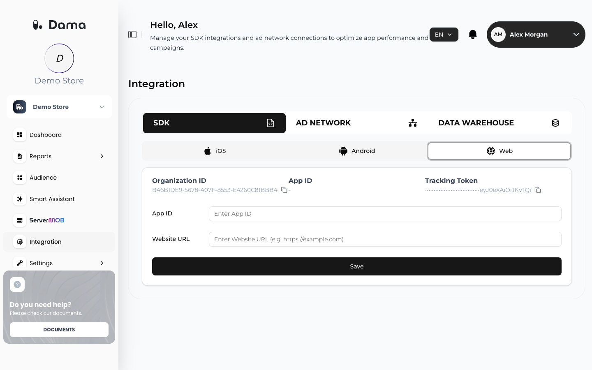

The DAMA Tracking API lets you send events to DAMA from your website, mobile app or server. Events you send appear in your DAMA reports and can be used in audiences. The DAMA Web SDK sends its events to this same API. Use the API directly when no SDK fits your platform or when you send events from your own backend.

The API is for sending events only. Reports, analyses and audiences are available in the DAMA panel.

## Base URL

Send events to **your collection URL**, which DAMA provides during onboarding. The examples in these docs use the placeholder `https://collect.example.com`; replace it with your own.

| Method | Path | Reference |
|---|---|---|
| `POST` | `/tracking/{organization_id}` | [Track an event](/api-reference/track-event) |

## Authentication

Every request needs two values, both found on **Integration → SDK** in the DAMA panel:

- **Organization ID**: goes in the URL path.
- **Tracking Token**: goes in the `Authorization` header as the raw value, **without** a `Bearer` prefix.

If you don't see **Tracking Token** on this tab, ask your DAMA contact for it.

<Frame>
  
</Frame>

```bash cURL
curl -X POST "https://collect.example.com/tracking/YOUR_ORGANIZATION_ID" \
  -H "Authorization: YOUR_TRACKING_TOKEN" \
  -H "Content-Type: application/json" \
  -d '{ "event_name": "page_view", "event_time": 1760947200000 }'
```

<Warning>
A Tracking Token is valid for one Organization ID only. Using it with a different Organization ID fails with `ERR_AUTH_FAILED`. Each website or app in your company has its own Organization ID and Tracking Token.
</Warning>

## Limits

| Limit | Value |
|---|---|
| Events per request | 1 |
| Request body size | 32,768 bytes (32 KB) |
| Required fields | `event_name`, `event_time` |
| `event_time` range | From 1 January 2020 (UTC) up to 24 hours in the future |
| Text field length | 1,024 characters, unless a lower limit is listed in the [field reference](/setup/send-events#field-reference) |
| `event_items` | 100 items, 20 keys per item |
| `custom` | 40 keys |

DAMA can limit the number of requests per organization. When a request is over that limit, it is rejected with HTTP `429` and `ERR_RATE_LIMITED`; wait and retry.

## Responses

An accepted event returns HTTP `202`:

```json Success
{ "success": true }
```

A rejected request returns an error code with a matching HTTP status:

```json Error
{ "success": false, "error": "ERR_VALIDATION" }
```

<ResponseField name="success" type="boolean" required>
  `true` when the event was accepted.
</ResponseField>
<ResponseField name="error" type="string">
  Error code, present when `success` is `false`.
</ResponseField>

## Error codes

| Error | HTTP status | Meaning | What to do |
|---|---|---|---|
| `ERR_AUTH_REQUIRED` | 401 | No `Authorization` header. | Send your Tracking Token. |
| `ERR_AUTH_FAILED` | 401 | The token is not valid, or it belongs to a different Organization ID. | Copy the Organization ID and Tracking Token again from the same tab on **Integration → SDK**. |
| `ERR_PAYLOAD_TOO_LARGE` | 413 | The body is larger than 32,768 bytes. | Send fewer items or shorter parameters. |
| `ERR_VALIDATION` | 422 | The Organization ID or the body is invalid: missing `event_name` or `event_time`, a field that is not in the reference, a plain-text email, phone or name, a hash that is not 64 hex characters, a currency that is not three letters, or an `event_time` out of range. Nothing from the request is stored. | Fix the payload. See the [field reference](/setup/send-events#field-reference). |
| `ERR_ORGANIZATION_MISMATCH` | 422 | `organization_id` in the body differs from the one in the URL. | Send the same ID, or leave it out of the body. |
| `ERR_RATE_LIMITED` | 429 | Too many requests for this organization. | Retry later with backoff. |
| `ERR_BUFFER_FULL` | 503 | DAMA cannot accept events right now. The event was not stored. | Retry with backoff. |
| `ERR_BUFFER_UNAVAILABLE` | 503 | DAMA cannot accept events right now. The event was not stored. | Retry with backoff. |

## Retries

Retrying is safe. Send a unique `event_id` with each event (8–64 characters of letters, digits, `_` or `-`): if DAMA receives the same `event_id` again, it keeps only the first copy. Retry on `429` and `503` with increasing delays, and on network errors when you did not get a response. Do not retry `4xx` validation and authentication errors without fixing the request first.

## Next steps

<CardGroup cols={2}>
  <Card title="Sending events" href="/api-reference/events">
    Identity, hashing, consent and server-side examples.
  </Card>
  <Card title="Track an event" href="/api-reference/track-event">
    Interactive endpoint reference with every field.
  </Card>
  <Card title="Send events" href="/setup/send-events">
    Standard events DAMA reports use, with the full field reference.
  </Card>
  <Card title="Web setup" href="/setup/web">
    Install the DAMA SDK on your website.
  </Card>
</CardGroup>
