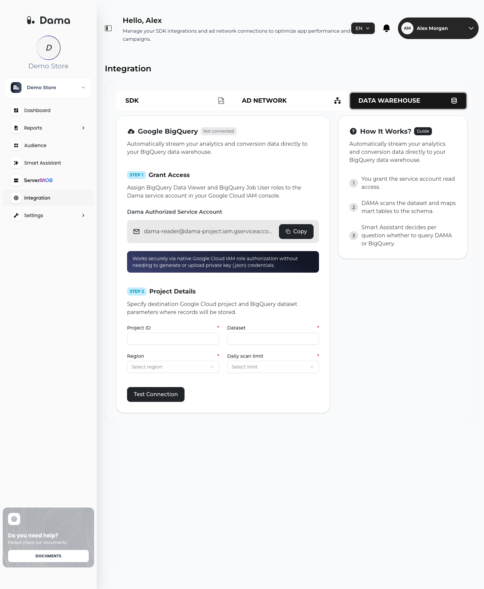

The BigQuery integration gives DAMA read-only access to a Google Analytics 4 (GA4) BigQuery export in your own Google Cloud project. Once connected:

- The [Smart Assistant](/user-guide/smart-assistant) can answer questions with read-only SQL queries against the dataset.
- You can switch the **Report data source** of your reports from DAMA to BigQuery.

DAMA never asks for a service account key. You grant two IAM roles to a DAMA service account and add a label to your dataset, and DAMA uses that identity to run queries in your project.

## Prerequisites

- A Google Cloud project with the **GA4 BigQuery export** enabled. GA4 writes daily tables named `events_YYYYMMDD` into a dataset that is usually called `analytics_<property_id>`.
- Permission in that project to grant IAM roles (for example, the Project IAM Admin or Owner role) and to edit the dataset's labels (for example, the BigQuery Data Owner role on the dataset).
- Billing enabled on the project. DAMA's queries run in your project and are billed to you. See [Costs and the daily scan limit](#costs-and-the-daily-scan-limit).
- Your DAMA company ID, for the ownership label in step 4. Your DAMA contact can give it to you.

## Connect BigQuery

<Steps>
  <Step title="Open the DATA WAREHOUSE tab">
    In the DAMA panel, go to **Integration → DATA WAREHOUSE**. The **Google BigQuery** card shows **Not connected**.
  </Step>
  <Step title="Copy the DAMA service account">
    In the **STEP 1** **Grant Access** section, find **Dama Authorized Service Account** and click **Copy**. The address looks like this:

    ```text Service account
    DAMA_SERVICE_ACCOUNT@your-dama-project.iam.gserviceaccount.com
    ```

    Always use the address shown in your panel. The example above is a placeholder.
  </Step>
  <Step title="Grant the two roles in Google Cloud IAM">
    In the Google Cloud console, open **IAM & Admin → IAM** for the project that holds your GA4 export. Click **Grant access**, paste the service account address as the principal, and add these roles:

    | Role | Role ID | Why DAMA needs it |
    | --- | --- | --- |
    | BigQuery Job User | `roles/bigquery.jobUser` | Lets DAMA run query jobs in your project. Grant it on the project. |
    | BigQuery Data Viewer | `roles/bigquery.dataViewer` | Lets DAMA read the tables, table metadata and labels of your GA4 dataset. |

    DAMA only reads the dataset you connect, so you can grant **BigQuery Data Viewer** on that dataset alone instead of the whole project: in **BigQuery**, open the dataset, click **Sharing → Permissions**, and add the service account with the **BigQuery Data Viewer** role.
  </Step>
  <Step title="Label the dataset with your DAMA company ID">
    Every DAMA customer grants access to the same service account, so DAMA also asks you to prove the dataset belongs to your company. Add this label to the dataset (not to the project):

    | Key | Value |
    | --- | --- |
    | `dama_group` | Your DAMA company ID, in **lowercase** |

    In the Google Cloud console, open **BigQuery**, select the dataset, click **Edit details**, and add the label under **Labels**. Or use the `bq` command-line tool:

    ```bash bq
    bq update --set_label dama_group:your-company-id-in-lowercase your-project-id:analytics_123456789
    ```

    To connect one dataset to several DAMA companies, add one label per company with keys that start with `dama_group_`, for example `dama_group_2`.
  </Step>
  <Step title="Enter the project details">
    In the **STEP 2** **Project Details** section, fill in all four fields:

    | Field | What to enter |
    | --- | --- |
    | **Project ID** | The Google Cloud project ID (not the project name or number). It must start with a lowercase letter and be 6–30 characters of lowercase letters, digits and hyphens. |
    | **Dataset** | The GA4 export dataset name, for example `analytics_123456789`. Letters, digits and underscores only. |
    | **Region** | The location of the dataset: `us`, `eu`, `us-central1`, `us-east1`, `europe-west1`, `europe-west3` or `asia-southeast1`. |
    | **Daily scan limit** | The most data DAMA may scan per day: **10 GB**, **50 GB**, **100 GB**, **250 GB**, **500 GB** or **1000 GB**. |
  </Step>
  <Step title="Test the connection">
    Click **Test Connection**. DAMA saves the details and checks, in your project:

    1. That it can create query jobs (a dry-run query; checks **BigQuery Job User**).
    2. That it can read the dataset's table list (a dry-run query; checks **BigQuery Data Viewer** and that the dataset exists).
    3. That the dataset carries the `dama_group` label with your company ID.

    Dry runs are not billed by BigQuery. When all checks pass, you see **Connection verified successfully** and the card shows **Connected**.
  </Step>
</Steps>

<Frame>
  
</Frame>

<Note>
  Any change to the project details clears the previous test result. After you edit a field, click **Test Connection Again**. DAMA only treats the connection as **Connected** when the latest test against the current details passed.
</Note>

## Report data source

After the connection is verified, a **Report data source** card appears: *Choose which data source powers your Funnel, RFM and CLTV reports.*

| Option | What it means |
| --- | --- |
| **DAMA** (default) | Reports are built from the events your apps send to DAMA. |
| **BigQuery** | Reports are built from your GA4 export. |

The source applies to [Funnel Analysis](/user-guide/funnel), [RFM](/user-guide/rfm) and [cLTV](/user-guide/cltv), and also to [Retention Analysis](/user-guide/retention).

When you switch the source:

- You see *Report data source updated. Your reports may take a few minutes, or until tonight, to fully refresh.*
- Existing RFM and cLTV results are cleared, and new ones are built from the selected source during the next night's run.
- You can only select **BigQuery** while the connection is verified.

### How reports use your GA4 data

When the report data source is **BigQuery**, DAMA reads the `events_*` tables of your dataset:

| Report | What DAMA reads | Window | When it updates |
| --- | --- | --- | --- |
| [Funnel Analysis](/user-guide/funnel) | Events per session (`ga_session_id`), in funnel step order | The previous day. The first time it runs after the connection is verified, DAMA also fills in the last 90 days. | Every night |
| [RFM](/user-guide/rfm) | `purchase` events, revenue from `event_value_in_usd` | Last 365 days, recalculated in full | Once a week, on Thursday night. Also the first night after you switch the source, change the connected dataset or the apps in your company. |
| [cLTV](/user-guide/cltv) | `purchase` events | Last 6 months, recalculated in full | Once a week, on Thursday night. Also the first night after you switch the source, change the connected dataset or the apps in your company. |
| [Retention Analysis](/user-guide/retention) | GA4's `first_open` and `first_visit` events to place users in cohorts, and the event you analyze | The cohorts and periods you select | Each time you run an analysis |

- A customer is identified by `user_id` when it is set, and by `user_pseudo_id` otherwise.
- Monetary values from GA4 are in **USD**, because DAMA uses GA4's `event_value_in_usd` field.
- Results are assigned to your DAMA Web, iOS or Android app by matching the GA4 `platform` field. If you have no DAMA app for a platform, that platform's rows are skipped.
- In Retention Analysis, the event list also shows the event names from your GA4 export.

## Costs and the daily scan limit

All queries DAMA runs against your dataset are BigQuery jobs **in your project**, so BigQuery bills them to your project at your normal rates. DAMA does not charge you for BigQuery usage.

The **Daily scan limit** is one budget per calendar day (UTC), shared by everything DAMA runs against your dataset:

| Activity | How the limit applies |
| --- | --- |
| Smart Assistant questions | DAMA estimates each query with a dry run first. If a question would scan more than what is left for the day, DAMA does not run it and shows *This query would exceed your daily BigQuery scan limit.* |
| Nightly report jobs (Funnel, RFM, cLTV) | Each job is estimated with a dry run first. If it would scan more than what is left for the day, DAMA skips it that night. |
| Retention Analysis | Each query is capped at what is left for the day. When the limit is used up, the analysis can't run until the next day. |

Every query is also capped at the amount left for the day, so BigQuery stops a query rather than let it go over your limit.

<Tip>
  GA4 exports grow every day. If your reports stop updating after you switch to BigQuery, a job may be over your limit. Choose a higher **Daily scan limit** and click **Test Connection Again**.
</Tip>

## What DAMA can and cannot do with this access

- DAMA only runs read-only `SELECT` queries. The Smart Assistant checks every generated query with a dry run and refuses anything that is not a single `SELECT` or that reads tables outside the connected dataset.
- DAMA does not write, modify or delete anything in your BigQuery project.
- DAMA checks the `dama_group` label every night. If you remove the label, DAMA stops reading the dataset and the card no longer shows **Connected**. Removing the IAM roles in Google Cloud also stops DAMA's access.

## Disconnect

Click **Disconnect**, then confirm in **Disconnect BigQuery?**.

- The connection details are removed. You can reconnect at any time.
- If the report data source was **BigQuery**, it switches back to **DAMA** automatically, and RFM and cLTV data built from BigQuery is cleared.

Disconnecting in DAMA does not remove the IAM roles or the label. Remove them in Google Cloud if you no longer want DAMA's service account to have access.

## Troubleshooting

When a test fails, a **Connection test failed** card explains the reason.

<AccordionGroup>
  <Accordion title="Grant the service account the BigQuery Job User role and try again.">
    The first check (creating a query job) was denied. Make sure **BigQuery Job User** is granted to the exact service account address shown in the panel, on the project you entered in **Project ID**. IAM changes can take a few minutes to apply.
  </Accordion>
  <Accordion title="Grant the service account the BigQuery Data Viewer role and try again.">
    DAMA could create a job but could not read the dataset or its labels. Grant **BigQuery Data Viewer** to the service account on the project or on the dataset.
  </Accordion>
  <Accordion title="Check that the Project ID and Dataset are correct.">
    BigQuery could not find the dataset. Check for typos, use the project ID rather than the project name, and confirm the dataset is in that project. The dataset name is case-sensitive.
  </Accordion>
  <Accordion title="Something went wrong while testing the connection. Please try again.">
    If DAMA could reach your dataset but the card still shows **Not connected**, the `dama_group` label is most likely missing or has the wrong value. Check that the label is on the dataset (not the project), that the key is exactly `dama_group`, and that the value is your company ID in lowercase. Then click **Test Connection Again**.
  </Accordion>
  <Accordion title="Invalid Project ID format (must start with a lowercase letter, 6-30 characters). / Invalid Dataset name.">
    The Project ID must start with a lowercase letter and be 6–30 characters of lowercase letters, digits and hyphens. The Dataset may only contain letters, digits and underscores.
  </Accordion>
  <Accordion title="Dama could not verify access to this BigQuery project. Make sure the service account has the required roles and try again.">
    BigQuery returned an error DAMA could not classify, or could not be reached. Check that the BigQuery API is enabled and that billing is active on the project, then try again.
  </Accordion>
  <Accordion title="This feature isn't available right now. Please contact support.">
    The BigQuery integration is not available for your account at the moment. Ask your DAMA contact to enable it.
  </Accordion>
  <Accordion title="Verify the BigQuery connection before switching your report data source to it.">
    You tried to select **BigQuery** as the report data source while the connection is not verified. Run **Test Connection** first.
  </Accordion>
</AccordionGroup>
