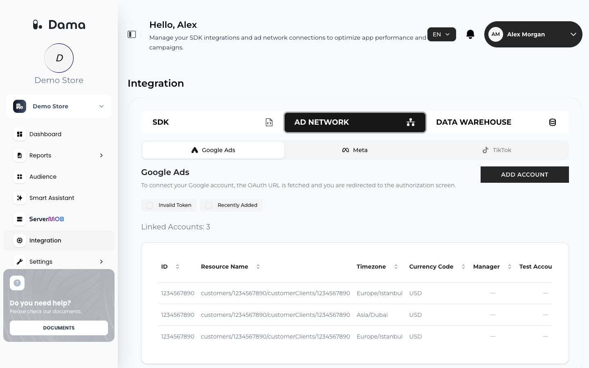
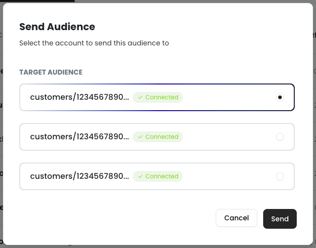

The Google Ads integration lets you send audiences you build in DAMA to Google Ads as Customer Match user lists. You connect with your Google account through Google's own sign-in screen (OAuth), so DAMA never sees your Google password.

## Prerequisites

- A Google account with access to the Google Ads account(s) you want to use. If you sign in with a manager (MCC) account, DAMA also lists the active client accounts under it.
- A Google Ads account that is allowed to use Customer Match under Google's policies.
- Users who are identified in DAMA by a hashed email address (`user_email_hash`) and whose most recent recorded consent grants **ads** consent. DAMA only uploads users who meet both conditions. See [Identify users](/setup/identify-users) and [Consent](/setup/identify-users#consent).

## Connect a Google Ads account

<Steps>
  <Step title="Open the Google Ads tab">
    Go to **Integration → AD NETWORK → Google Ads**.
  </Step>
  <Step title="Start the authorization">
    Click **ADD ACCOUNT**. DAMA redirects you to Google's sign-in and consent screen.
  </Step>
  <Step title="Sign in and approve access">
    Choose the Google account and approve the requested access. DAMA asks for these Google permissions:

    | Permission | Used for |
    | --- | --- |
    | Google Ads | Listing your ad accounts |
    | Google Cloud Platform | Required by Google for the Data Manager API |
    | Data Manager | Creating Customer Match lists and uploading members |
  </Step>
  <Step title="Return to DAMA">
    After you approve, Google sends you back to the **Integration** screen. Your accounts appear in the table and the **Linked Accounts** count updates.
  </Step>
</Steps>

<Frame>
  
</Frame>

### The linked accounts table

| Column | Meaning |
| --- | --- |
| **ID** | The Google Ads customer ID |
| **Resource Name** | Google's resource name for the account |
| **Timezone** | The account's time zone |
| **Currency Code** | The account's currency |
| **Manager** | A check mark if the account is a manager (MCC) account |
| **Test Account** | A check mark if it is a Google Ads test account |
| **Token Validate** | A green check mark while DAMA's access token for this connection is valid, a grey dash when it has expired |

Use the filters above the table to narrow the list:

- **Invalid Token** shows accounts whose access token has expired.
- **Recently Added** shows accounts linked in the last 30 days.

### Refresh an expired token

Google access tokens expire. When a token has expired, the **Token Validate** column shows a grey dash. Hover over it to see *Token expired. Click to refresh.*, then click it. DAMA gets a new access token from Google with the refresh token issued when you connected, so you don't need to sign in again. You see *Token refreshed successfully.* when it worked.

If you see *Token refresh failed.*, click **ADD ACCOUNT** and authorize again.

<Warning>
  Check that the token is valid before you send an audience. DAMA does not refresh Google tokens automatically when you send, so sending with an expired token fails.
</Warning>

## Send an audience to Google Ads

<Steps>
  <Step title="Open the audience list">
    Go to **Audience**. Each row has a Google Ads icon and a Meta icon in the **SEND TO** column.
  </Step>
  <Step title="Choose Google Ads">
    Click the Google Ads icon on the audience you want to send. The **Send Audience** dialog opens.
  </Step>
  <Step title="Pick the target account">
    Under **TARGET AUDIENCE**, select one of your linked Google Ads accounts. If none are linked, you see *No connected Google Ads account found.* Link one first.
  </Step>
  <Step title="Send">
    Click **Send**. When the upload succeeds you see *Audience sent successfully.*
  </Step>
</Steps>

<Frame>
  
</Frame>

The new user list appears in Google Ads under your audience segments, with the same name as the DAMA audience. Google needs time to match the uploaded users, so the list size in Google Ads is not available right away.

### What DAMA sends

When you click **Send**, DAMA:

1. Takes the users in the DAMA audience and keeps those identified by a hashed email address (`user_email_hash`). Users DAMA only knows by an anonymous ID are left out.
2. Looks up each user's most recent recorded consent and keeps only users who granted **ads** consent. Users who denied it, or have no consent recorded, are not sent.
3. Removes duplicates.
4. Creates a new Customer Match list in the selected account through Google's Data Manager API and uploads the SHA-256 email hashes in batches of up to 10,000. DAMA uploads the hash your app sent; no plain email address is involved. DAMA declares ad user data and ad personalization consent as granted for the uploaded users, because only users with granted ads consent are included.

The list's membership duration is **180 days**.

<Note>
  The email hash is the only identifier DAMA sends. For Google to match your users, the hash must be the SHA-256 of the trimmed, lowercase email address, as described in [Identify users](/setup/identify-users).
</Note>

### Sync frequency

Sending is a one-time upload. DAMA does not keep the Google Ads list in sync with the DAMA audience afterwards, and there is no automatic schedule.

To push an updated set of users, create a new audience in DAMA and send it. Google Ads does not allow two user lists with the same name in one account, so sending the same DAMA audience to the same account a second time fails.

## Import a list from a CSV file

You can also upload your own list of email addresses to Google Ads through DAMA. On the **Audience** screen, click **CREATE AUDIENCE**, then **Import from CSV** or **Import from Platform**, select a linked Google Ads account and upload a `.csv` file. See [Import an audience from a CSV file](/user-guide/audiences#import-an-audience-from-a-csv-file) for the steps.

For Google Ads, the CSV file must have a header row with these columns:

| Column | Required | Values |
| --- | --- | --- |
| `email` | Yes | One email address per row, either as plain text or already hashed with SHA-256 (64 hexadecimal characters) |
| `ads_consent` | Yes | `true`, `1`, `yes`, `granted` or `consent_granted` includes the row. `false`, `0`, `no`, `denied`, `consent_denied` or an empty value excludes it. |

```csv Example
email,ads_consent
jane@example.com,true
john@example.com,granted
alex@example.com,false
```

- DAMA trims and lowercases plain email addresses and hashes them with SHA-256 before upload. Values that are already SHA-256 hashes are uploaded as they are.
- Only rows with granted consent are uploaded. If the same address appears in several rows and any of them is not granted, that address is skipped.
- The file can be up to 8 MB and 200,000 rows.
- The new list is named after the file name without the extension, gets a membership duration of 180 days, and also appears in the DAMA **Audience** list.
- You can't import a second list with the same name within one day.

## Disconnect a Google Ads account

The DAMA panel has no option to remove a linked Google Ads account. To stop DAMA's access, remove DAMA from the third-party connections in your Google account's security settings. After that, the access token can no longer be refreshed and sending to that account fails. To have a linked account removed from the list in DAMA, ask your DAMA contact.

## Troubleshooting

<AccordionGroup>
  <Accordion title="Google authorization could not be started. / Google authorization URL could not be created.">
    DAMA could not create the Google authorization link. Try again. If it keeps failing, ask your DAMA contact for help.
  </Accordion>
  <Accordion title="Google Ads accounts could not be loaded.">
    DAMA could not read the linked accounts. Reload the page. If the token has expired, refresh it in the **Token Validate** column.
  </Accordion>
  <Accordion title="Failed to send audience.">
    Common causes:
    - The access token has expired. Refresh it in **Integration → AD NETWORK → Google Ads**.
    - A list with the same name already exists in that Google Ads account.
    - No user in the audience is identified by a hashed email address.
    - No user in the audience has granted ads consent.
    - The Google Ads account is not eligible for Customer Match.
  </Accordion>
  <Accordion title="No connected Google Ads account found.">
    Link an account in **Integration → AD NETWORK → Google Ads** first.
  </Accordion>
</AccordionGroup>
