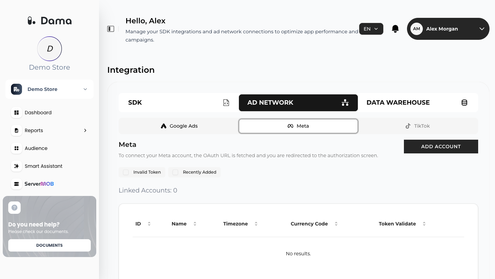

The Meta integration lets you send audiences you build in DAMA to your Meta ad accounts as Custom Audiences (customer list audiences). You connect with your Facebook account through Meta's own login screen (OAuth), so DAMA never sees your password.

## Prerequisites

- A Facebook account with access to the Meta ad account(s) you want to use, with permission to create audiences.
- Acceptance of Meta's Custom Audience terms for the ad account, if Meta requires it.
- Users who are identified in DAMA by a hashed email address (`user_email_hash`). Users DAMA only knows by an anonymous ID are not sent. See [Identify users](/setup/identify-users).

## Connect a Meta ad account

<Steps>
  <Step title="Open the Meta tab">
    Go to **Integration → AD NETWORK → Meta**.
  </Step>
  <Step title="Start the authorization">
    Click **ADD ACCOUNT**. DAMA redirects you to Facebook's login and consent screen.
  </Step>
  <Step title="Approve access">
    Sign in and approve the permissions Meta lists. They let DAMA read your ad accounts and create Custom Audiences in them (for example `ads_management`, `ads_read` and `business_management`).
  </Step>
  <Step title="Return to DAMA">
    After you approve, you are sent back to the **Integration** screen. DAMA exchanges the short-lived login token for a long-lived token, checks that it is valid, and lists your ad accounts.
  </Step>
</Steps>

<Frame>
  
</Frame>

### The linked accounts table

| Column | Meaning |
| --- | --- |
| **ID** | The Meta ad account ID |
| **Name** | The ad account name |
| **Timezone** | The ad account's time zone |
| **Currency Code** | The ad account's currency |
| **Token Validate** | A green check mark while DAMA's token for this connection is valid, a grey dash when it has expired |

Use **Invalid Token** to show accounts with an expired token, and **Recently Added** to show accounts linked in the last 30 days.

### When a token expires

Meta does not issue refresh tokens, so an expired or revoked token can't be renewed in place. If **Token Validate** shows a grey dash (*Token expired. Click to refresh.*), click it: DAMA checks the token again. If it has expired or was revoked (for example after a password change or after removing the app in Facebook), click **ADD ACCOUNT** and authorize again.

## Send an audience to Meta

<Steps>
  <Step title="Open the audience list">
    Go to **Audience**.
  </Step>
  <Step title="Choose Meta">
    Click the Meta icon in the **SEND TO** column of the audience. The **Send Audience** dialog opens.
  </Step>
  <Step title="Pick the ad account">
    Under **TARGET AUDIENCE**, select a linked Meta ad account. If none are linked, you see *No connected Meta account found.*
  </Step>
  <Step title="Send">
    Click **Send**. When the upload succeeds you see *Audience sent to Meta successfully.*
  </Step>
</Steps>

The Custom Audience appears in Meta Ads Manager under **Audiences**, with the same name as the DAMA audience. Meta needs time to match the uploaded users before it shows an audience size.

### What DAMA sends

When you click **Send**, DAMA:

1. Takes the users in the DAMA audience and keeps those identified by a hashed email address (`user_email_hash`).
2. Removes duplicates.
3. Creates a new Custom Audience in the selected ad account (customer list, customer file source *user provided only*) and adds the SHA-256 email hashes to it. DAMA uploads the hash your app sent; no plain email address is involved.

- The email hash is the only identifier DAMA sends. For Meta to match your users, the hash must be the SHA-256 of the trimmed, lowercase email address, as described in [Identify users](/setup/identify-users).
- DAMA does not filter users by recorded ad consent when sending to Meta: every user in the audience who is identified by an email hash is sent. (Sending to [Google Ads](/integrations/google-ads#what-dama-sends) includes only users with granted ads consent.)
- DAMA does not set a retention period on the Custom Audience, so Meta's default applies.

### Sync frequency

Sending is a one-time upload. DAMA does not keep the Meta audience in sync with the DAMA audience afterwards, and there is no automatic schedule. Each send creates a new Custom Audience. To update the users in Meta, send the audience again (or create and send a new DAMA audience) and use the newest Custom Audience in your ad sets.

## Import a list from a CSV file

On the **Audience** screen, click **CREATE AUDIENCE**, then **Import from CSV** or **Import from Platform**, and select a linked Meta ad account. See [Import an audience from a CSV file](/user-guide/audiences#import-an-audience-from-a-csv-file) for the steps.

For Meta, the CSV file needs a header row with an `email` column:

```csv Example
email
jane@example.com
john@example.com
```

- The `email` column can contain plain email addresses or SHA-256 hashes (64 hexadecimal characters). DAMA trims, lowercases and hashes plain addresses before upload; hashes are uploaded as they are.
- DAMA creates a Custom Audience named after the file name (without the extension). The list also appears in the DAMA **Audience** list.
- The file can be up to 8 MB and 200,000 rows.
- You can't import a second list with the same name within one day.

## Disconnect a Meta account

The DAMA panel has no option to remove a linked Meta account. To stop DAMA's access, remove DAMA in your Facebook settings under **Business integrations**. After that, the token is no longer valid and sending to that account fails. To have a linked account removed from the list in DAMA, ask your DAMA contact.

## Troubleshooting

<AccordionGroup>
  <Accordion title="Meta authorization could not be started. / Meta authorization URL could not be created.">
    DAMA could not create the authorization link. Try again. If it keeps failing, ask your DAMA contact for help.
  </Accordion>
  <Accordion title="Failed to send audience to Meta.">
    Common causes:
    - The token has expired or was revoked. Click **ADD ACCOUNT** and authorize again.
    - No user in the audience is identified by a hashed email address.
    - The ad account has not accepted Meta's Custom Audience terms, or your Facebook user lacks permission on the ad account.
  </Accordion>
  <Accordion title="Meta accounts could not be loaded.">
    DAMA could not read your ad accounts from Meta. Check that the token is valid and that your user still has access to the ad accounts.
  </Accordion>
</AccordionGroup>
