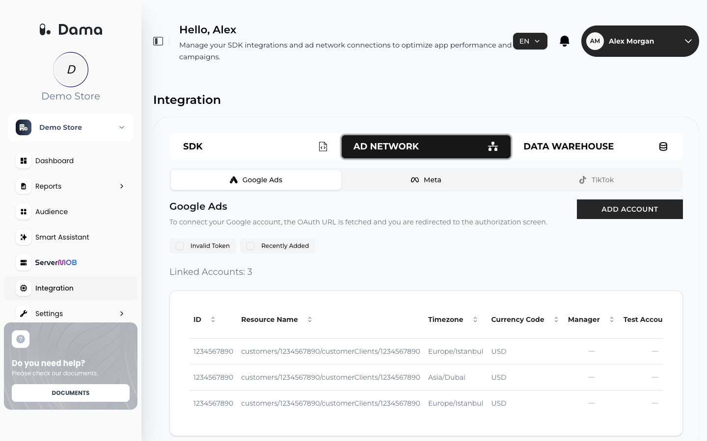

The **Integration** screen in the DAMA panel is where you connect DAMA to the systems around it. To open it, select a company and click **Integration** in the left menu. The screen has three tabs:

| Tab | What it is for |
| --- | --- |
| **SDK** | Your **iOS**, **Android** and **Web** apps, with the **Organization ID** and **Tracking Token** you need to send events to DAMA. See [Setup overview](/setup/overview). |
| **AD NETWORK** | The ad accounts DAMA can send audiences to: **Google Ads** and **Meta**. |
| **DATA WAREHOUSE** | A read-only connection to the **Google BigQuery** dataset that holds your GA4 export. |

<Frame>
  
</Frame>

## Available integrations

<CardGroup cols={2}>
  <Card title="Google BigQuery" href="/integrations/bigquery">
    Give DAMA read-only access to your GA4 BigQuery export so the Smart Assistant can query it and, if you choose, so it powers your Funnel Analysis, Retention Analysis, RFM and cLTV reports.
  </Card>
  <Card title="Google Ads" href="/integrations/google-ads">
    Link Google Ads accounts and send DAMA audiences to them as Customer Match lists.
  </Card>
  <Card title="Meta" href="/integrations/meta">
    Link Meta ad accounts and send DAMA audiences to them as Custom Audiences.
  </Card>
</CardGroup>

<Note>
  **TikTok** is shown under **AD NETWORK** but is not yet available: the tab can't be opened, and audiences can't be sent to TikTok.
</Note>

## How the pieces fit together

1. Your apps send events to DAMA. To use audiences in ad platforms, identify signed-in users with a hashed email address. See [Identify users](/setup/identify-users).
2. DAMA builds reports from those events: [Funnel Analysis](/user-guide/funnel), [Retention Analysis](/user-guide/retention), [RFM](/user-guide/rfm) and [cLTV](/user-guide/cltv).
3. From a report you create an audience. It appears on the [Audience](/user-guide/audiences) screen.
4. From the **Audience** screen you send the audience to a linked Google Ads or Meta account.

If you connect BigQuery, you can also choose BigQuery instead of DAMA as the data source for your reports. See [Report data source](/integrations/bigquery#report-data-source).

## Who can manage integrations

Members of the company can open the **Integration** screen, link Google Ads and Meta accounts, and connect, change or disconnect BigQuery. To control who has access to a company, see [Team and permissions](/user-guide/team-and-permissions).
