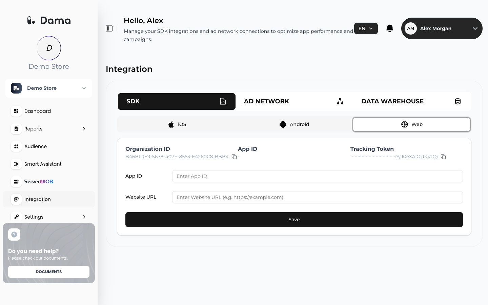

This quickstart installs the Web SDK on a website. For apps, start with the [Setup overview](/setup/overview).

<Steps>
  <Step title="Get your credentials">
    If you don't have a DAMA account or company yet, [create an account](/user-guide/account#create-an-account) and [add a company](/user-guide/companies#add-a-company) first.

    Sign in to the DAMA panel, open your company and go to **Integration → SDK → Web**. Copy the **Organization ID** and the **Tracking Token**. If you don't see **Tracking Token** on this tab, ask your DAMA contact for it.

    You also need your collection URL, which DAMA provides during onboarding. The examples use `https://collect.example.com`.

    <Frame>
      
    </Frame>
  </Step>
  <Step title="Add the script tag">
    Put the SDK in the `<head>` of every page, replacing the collection URL (twice), the Organization ID and the token:

    ```html
    <script src="https://collect.example.com/sdk/dama.js?id=YOUR_ORGANIZATION_ID&token=YOUR_TRACKING_TOKEN&collect=https://collect.example.com"></script>
    ```

    The SDK starts a session and sends a `page_view` on every page load. Full options are in [Web](/setup/web).
  </Step>
  <Step title="Send ecommerce events">
    Send the standard events your reports rely on, especially `purchase` with its value and currency. Code that runs while the page is still loading must wait for `DOMContentLoaded`:

    ```javascript
    document.addEventListener('DOMContentLoaded', function () {
      damaDP('purchase', {
        transaction_id: 'ORDER-1001',
        event_transaction_id: 'ORDER-1001',
        value: 2499.9,
        currency: 'TRY'
      });
    });
    ```

    See [Send events](/setup/send-events) for every standard event and which report uses it, and add the [session start snippet](/setup/send-events#session-start) if you use Retention Analysis.
  </Step>
  <Step title="Identify signed-in users">
    After login or signup, identify the user so their activity is linked across sessions and devices, and record their ad consent if you plan to send audiences to Google Ads. See [Identify users](/setup/identify-users).
  </Step>
  <Step title="Verify">
    Check the requests in your browser and the **Dashboard** in the panel. See [Verify your installation](/setup/verify-installation).
  </Step>
</Steps>

## Next steps

<CardGroup cols={2}>
  <Card title="Connect BigQuery" icon="database" href="/integrations/bigquery" />
  <Card title="Set up ServerMob" icon="server" href="/servermob/overview" />
  <Card title="Build audiences" icon="users" href="/user-guide/audiences" />
  <Card title="Read your funnel" icon="filter" href="/user-guide/funnel" />
</CardGroup>
