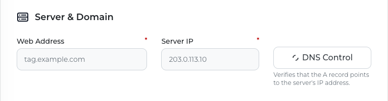

ServerMob runs on a subdomain of your website, for example `tag.example.com` for `www.example.com`. All GTM scripts and tracking requests are served from this subdomain, so it must point to your ServerMob server before you change the GTM snippet on your site.

## Prerequisites

- ServerMob is enabled for your company (see [Opening ServerMob](/servermob/overview#opening-servermob)).
- Access to the DNS settings of your domain.

## Steps

<Steps>
  <Step title="Agree on the subdomain with DAMA">
    Choose a subdomain of your website's domain that you don't use for anything else, such as `tag.example.com`, and tell your DAMA contact. DAMA sets up your ServerMob server for that subdomain and enters it in the portal together with the server's IP address.

    Until this is done, the portal shows **Server and domain details haven't been assigned yet, so settings can't be saved. Please contact the Dama team.**
  </Step>
  <Step title="Look up your Web Address and Server IP">
    Open ServerMob from the DAMA panel, select your company and find the **Server & Domain** section:

    <ParamField path="Web Address" type="string">
      Your ServerMob subdomain, for example `https://tag.example.com`. Read-only; assigned by DAMA.
    </ParamField>
    <ParamField path="Server IP" type="string">
      The IP address of your ServerMob server. Read-only; assigned by DAMA. Your DNS record points to this address.
    </ParamField>

    <Frame>
      
    </Frame>
  </Step>
  <Step title="Add the DNS record at your DNS provider">
    Create an **A** record for the subdomain that points to the **Server IP**:

    | Type | Name / Host | Value / Target | TTL |
    |---|---|---|---|
    | `A` | `tag` (for `tag.example.com`) | Your **Server IP** | Auto / default |
  </Step>
  <Step title="Wait for DNS propagation">
    DNS changes can take anywhere from a few minutes to several hours to propagate, depending on your provider and the record's TTL.
  </Step>
  <Step title="Click DNS Control">
    In **Server & Domain**, click **DNS Control**. When the check passes, the button shows a green check and the portal shows **DNS verification successful.** When it fails, the button shows a red cross and the portal shows **DNS verification failed.**
  </Step>
</Steps>

<Warning>
Your subdomain must answer over HTTPS, because your website loads `https://tag.example.com/gtm.js`. Your ServerMob server does not issue a certificate for your subdomain by itself. Before you change your GTM snippet, confirm with your DAMA contact how HTTPS is set up for your subdomain, and check it with the [Verify](#verify) step below.
</Warning>

## What DNS Control checks

**DNS Control** passes when your subdomain has an A record. It does not show which address the record returns, so a record that points to the wrong server also passes. Check the record yourself:

```bash Terminal
nslookup tag.example.com
```

The answer should be your **Server IP**. If your DNS provider proxies the record (for example to serve HTTPS), the lookup returns the provider's addresses instead; in that case, check that the record in your DNS provider's settings has your **Server IP** as its target.

## Verify

Once DNS has propagated, open these URLs in your browser (replace `tag.example.com` with your subdomain):

- `https://tag.example.com/healthz` returns `ok`.
- `https://tag.example.com/gtm.js?id=GTM-XXXXXXX` (with your container ID) returns JavaScript.

If both work, continue with [GTM setup](/servermob/gtm-setup).

## Troubleshooting

See [Troubleshooting](/servermob/troubleshooting#domain-and-dns) for DNS check failures, HTTPS errors and propagation issues.
