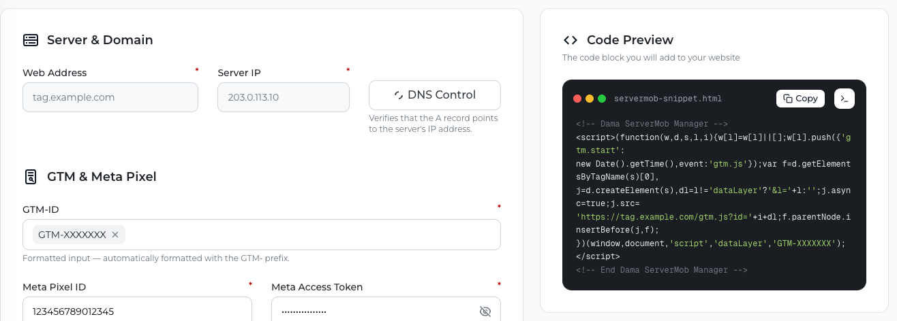

ServerMob serves your existing Google Tag Manager **web** container from your subdomain. You don't need a separate server container: you keep editing and publishing tags in GTM as usual, and the only change on your website is that the GTM snippet loads `gtm.js` from your subdomain instead of from Google.

## Prerequisites

- Your subdomain points to ServerMob and answers over HTTPS. See [Domain setup](/servermob/domain-setup).
- Your GTM container ID, in the format `GTM-XXXXXXX`. You can find it at the top of your workspace in Google Tag Manager.
- Access to your website's HTML template (or to the place where your current GTM snippet is installed).

## Steps

<Steps>
  <Step title="Enter your container ID in ServerMob">
    In the ServerMob portal, go to **GTM & Meta Pixel** and type your container ID in **GTM-ID**. Press Enter (or type a comma or space) to add it. You can type just the part after `GTM-`; the portal adds the `GTM-` prefix and converts letters to uppercase.

    <ParamField path="GTM-ID" type="string[]" required>
      One or more container IDs in the format `GTM-XXXXXXX`. At least one is required to save. To remove an ID, click the **×** next to it.
    </ParamField>

    Then click **Save Changes** and wait for **Settings saved.** (see [Saving your settings](/servermob/overview#saving-your-settings) for the other fields the form requires).
  </Step>
  <Step title="Copy the snippet from Code Preview">
    **Code Preview** shows the code block to add to your website, already filled in with your **Web Address** and the first saved **GTM-ID**. Click **Copy**.

    The snippet is built from your saved settings, so save first if you just changed your GTM-ID. It looks like this:

    ```html head
    <!-- Dama ServerMob Manager -->
    <script>(function(w,d,s,l,i){w[l]=w[l]||[];w[l].push({'gtm.start':
    new Date().getTime(),event:'gtm.js'});var f=d.getElementsByTagName(s)[0],
    j=d.createElement(s),dl=l!='dataLayer'?'&l='+l:'';j.async=true;j.src=
    'https://tag.example.com/gtm.js?id='+i+dl;f.parentNode.insertBefore(j,f);
    })(window,document,'script','dataLayer','GTM-XXXXXXX');</script>
    <!-- End Dama ServerMob Manager -->
    ```

    If you want to use GTM Preview, copy the **Debug Mode** version instead; see [GTM Preview mode](#gtm-preview-mode).

    <Frame>
      
    </Frame>
  </Step>
  <Step title="Replace your current GTM snippet">
    Remove the standard GTM `<script>` snippet that loads from `www.googletagmanager.com`, and paste the ServerMob snippet as high as possible inside the `<head>` of every page. Keeping both would load the container twice and double-count events.
  </Step>
  <Step title="Update the noscript fallback (optional)">
    If your site uses GTM's `<noscript>` fallback after the opening `<body>` tag, point it to your subdomain as well:

    ```html body
    <noscript><iframe src="https://tag.example.com/ns.html?id=GTM-XXXXXXX"
    height="0" width="0" style="display:none;visibility:hidden"></iframe></noscript>
    ```
  </Step>
  <Step title="Deploy">
    Deploy the updated template to your website. Any version you publish in GTM afterwards is picked up by ServerMob automatically.
  </Step>
</Steps>

<Note>
If you load the Google tag (`gtag.js`) directly instead of GTM, ServerMob also serves `https://tag.example.com/gtag/js?id=G-XXXXXXX` (IDs starting with `G-` or `GT-`).
</Note>

## What gets routed through your subdomain

When ServerMob serves your container, it rewrites the vendor URLs inside it so these requests go through your subdomain:

- Google Tag Manager, Google Analytics 4 and Google Ads requests
- Meta Pixel (`fbevents.js` and the Pixel events)
- TikTok Pixel (the Pixel script and its events)

This applies to tags that are loaded **through your GTM container**. A tag that is hard-coded directly in your site's HTML still talks to its vendor directly. To route a Meta or TikTok Pixel through ServerMob (required for the server-side APIs), deploy it as a tag inside GTM.

## GTM Preview mode

Turn on **Debug Mode** in **Code Preview** (the terminal icon next to **Copy**) to get a version of the snippet for GTM Preview. When the page URL contains GTM's preview parameters, this version passes them on, and ServerMob hands the request over to Google so that Preview and Tag Assistant can load your workspace. For all other visitors it works exactly like the standard snippet, so you can keep it installed.

In Preview mode the container itself loads from `www.googletagmanager.com`; this is expected.

## Verify

1. Open your website with your browser's developer tools on the **Network** tab.
2. Reload the page and filter by your subdomain (for example `tag.example.com`).
3. Check that:
   - `gtm.js?id=GTM-XXXXXXX` loads from your subdomain with status `200`.
   - Tracking requests go to your subdomain instead of the vendor domains, for example `/ga/g/collect` for GA4, `/meta/tr/` for the Meta Pixel and `/tiktok/api/v2/pixel` for the TikTok Pixel.
4. In Google Analytics 4, open **Realtime** and confirm your visit appears.
5. In the ServerMob portal, **Data Preview** starts showing requests for today.

<Tip>
ServerMob caches your container for a few minutes. After you publish a new GTM version, allow a few minutes before it appears on your site.
</Tip>

## Troubleshooting

See [Troubleshooting](/servermob/troubleshooting#gtm) for `invalid id`, `bad gateway` and caching issues.
