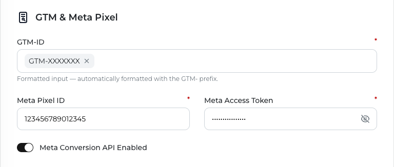

When the Meta Conversions API (CAPI) is turned on, ServerMob sends a server-side copy of each Meta Pixel event that goes through your subdomain to Meta. The browser Pixel request is still forwarded to Meta as usual; the CAPI call runs in the background and does not delay the page.

## Prerequisites

- ServerMob is serving your GTM container from your subdomain. See [GTM setup](/servermob/gtm-setup).
- Your Meta Pixel is deployed **as a tag inside GTM**. A Pixel hard-coded in your site's HTML sends its requests directly to Meta, so ServerMob never sees them and can't mirror them.
- Your **Meta Pixel ID** (Meta Events Manager → **Data sources** → your Pixel).
- A **Conversions API access token** for that Pixel (Meta Events Manager → your Pixel → **Settings** → **Conversions API** → **Generate access token**).

## Steps

<Steps>
  <Step title="Open GTM & Meta Pixel">
    Open ServerMob from the DAMA panel, select your company and find the **GTM & Meta Pixel** section.
  </Step>
  <Step title="Enter your credentials">
    <ParamField path="Meta Pixel ID" type="string">
      The ID of the Pixel that should receive server-side events. Digits only. Required when **Meta Conversion API Enabled** is on.
    </ParamField>
    <ParamField path="Meta Access Token" type="string">
      The Conversions API access token generated for that Pixel. Hidden by default; click the eye icon to show it. Required when **Meta Conversion API Enabled** is on.
    </ParamField>
  </Step>
  <Step title="Turn on Meta Conversion API Enabled">
    Turn on the **Meta Conversion API Enabled** switch. Turn it off to pause server-side events without deleting your Pixel ID and token.
  </Step>
  <Step title="Save">
    Click **Save Changes** and wait for **Settings saved.** See [Saving your settings](/servermob/overview#saving-your-settings) for the other fields the form requires.
  </Step>
</Steps>

<Frame>
  
</Frame>

<Warning>
Treat the access token like a password. Only enter it in the ServerMob portal.
</Warning>

## What ServerMob sends

For each Pixel event, ServerMob sends one Conversions API event with `action_source` set to `website` and these fields when they are available:

| Field | Source |
|---|---|
| `event_name` | The Pixel event name (for example `PageView`, `AddToCart`, `Purchase`) |
| `event_time` | The Pixel event timestamp, or the current time if missing |
| `event_id` | The Pixel's event ID (see [Deduplication](#deduplication)) |
| `event_source_url` | The page URL |
| `user_data.fbp`, `user_data.fbc` | The Meta browser and click IDs |
| `user_data.client_ip_address` | The visitor's IP address |
| `user_data.client_user_agent` | The visitor's browser user agent |
| `user_data.em`, `ph`, `fn`, `ln`, `ct`, `st`, `zp`, `country`, `external_id` | Advanced Matching values, forwarded exactly as the Pixel sends them (already hashed by the Pixel) |
| `custom_data.value`, `currency`, `content_type`, `content_ids`, `contents` | Commerce parameters from the Pixel event |

ServerMob does not hash or add customer data itself. To improve Event Match Quality, enable Advanced Matching in your Pixel tag so the Pixel includes hashed identifiers.

<Note>
ServerMob sends every Pixel event it sees to the Pixel ID configured in the portal. If your GTM container runs more than one Meta Pixel, events from all of them are sent server-side to this one Pixel.
</Note>

## Deduplication

Meta deduplicates a browser event and a server event when both carry the same event ID and event name. ServerMob copies the Pixel's event ID into the CAPI event; it does not generate one. Set an event ID in your Pixel tag, for example:

```javascript Web
fbq('track', 'Purchase', { value: 49.90, currency: 'EUR' }, { eventID: 'ORDER-10045' });
```

If you use a GTM Meta Pixel tag template, map its event ID field to a unique value per event (for example a transaction ID or a GTM variable that generates an ID). Without an event ID, Meta can't reliably match the two copies.

## Verify

1. Open your site and trigger a Pixel event (for example a page view).
2. In your browser's **Network** tab, check that the Pixel request goes to `/meta/tr/` on your subdomain.
3. In the ServerMob portal, **CAPI DISPATCHED** in **Data Preview** counts the server-side events Meta accepted in the last 15 days. It should start to go up.
4. In Meta Events Manager, open your Pixel → **Overview** and check that events show **Conversions API** (or **Browser · Server**) as a connection method. Server events can take a few minutes to appear.
5. Check that deduplicated events appear as a single event rather than doubled counts.

## Good to know

- Each event is sent individually. If Meta rejects an event or the request fails, it is not retried.
- Turning **Meta Conversion API Enabled** off stops server-side events; the browser Pixel keeps working through your subdomain.

## Troubleshooting

See [Troubleshooting](/servermob/troubleshooting#meta-conversions-api).
