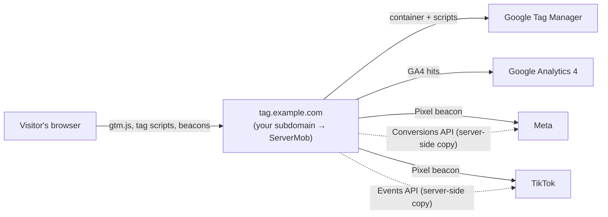
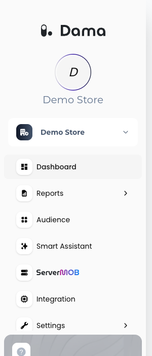
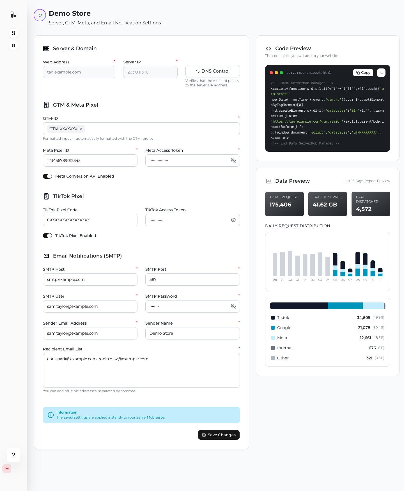

ServerMob is DAMA's first-party tagging service. Normally your website loads Google Tag Manager (GTM) and the tags inside it from Google, Meta and TikTok domains. With ServerMob, your website loads them from a subdomain you own, such as `tag.example.com`. ServerMob fetches the scripts, rewrites the third-party URLs inside them so they point back to your subdomain, and forwards the resulting tracking requests to each vendor. For Meta and TikTok, ServerMob can also send a server-side copy of each event to the Meta Conversions API and the TikTok Events API.

## How it works

1. Your site's GTM snippet requests `https://tag.example.com/gtm.js?id=GTM-XXXXXXX` instead of the Google URL.
2. ServerMob downloads your published GTM container from Google, rewrites the vendor URLs inside it (Google Tag Manager, Google Analytics, Google Ads, Meta Pixel, TikTok Pixel) to paths on your subdomain, and returns it to the browser.
3. When tags fire, the browser sends their requests to your subdomain. ServerMob forwards each one to the original vendor. Google Analytics hits are forwarded with the visitor's IP address so location reporting keeps working.
4. If you turned on the [Meta Conversions API](/servermob/meta-capi) or the [TikTok Events API](/servermob/tiktok-events-api), ServerMob also sends the event server-to-server, using the browser event's ID so the vendor can deduplicate the two.

The server-side calls run in the background, so they never slow down the response to the visitor's browser.

## Benefits

- **First-party delivery.** Tag scripts and tracking requests go to your own domain rather than to well-known third-party tracking domains, so blocklist-based ad blockers are less likely to stop them.
- **Server-side conversions.** Meta and TikTok events are also delivered from the server, so conversions can still be attributed when the browser request is lost.
- **No change to your tagging workflow.** You keep managing tags, triggers and variables in your existing GTM web container. ServerMob serves whatever version you publish.

## What you need

<CardGroup cols={2}>
  <Card title="ServerMob access" icon="key">
    ServerMob must be enabled for your company, and your user needs ServerMob access. Your DAMA contact activates both.
  </Card>
  <Card title="A subdomain and DNS access" icon="globe">
    For example `tag.example.com`, agreed with your DAMA contact, plus access to your DNS provider. See [Domain setup](/servermob/domain-setup).
  </Card>
  <Card title="A GTM web container" icon="tags">
    Your container ID (`GTM-XXXXXXX`). See [GTM setup](/servermob/gtm-setup).
  </Card>
  <Card title="Optional: Meta and TikTok credentials" icon="bolt">
    A Pixel ID or Pixel Code and an access token for each platform you want to send server-side events to.
  </Card>
</CardGroup>

## Opening ServerMob

ServerMob has its own portal, which you open from the DAMA panel:

<Steps>
  <Step title="Select your company">
    In the DAMA panel, switch to the company you want to set up.
  </Step>
  <Step title="Open ServerMOB">
    Click **ServerMOB** in the left sidebar. The ServerMob portal opens in a new tab and signs you in with your DAMA account.
  </Step>
  <Step title="Select the company in the portal">
    The portal opens on the first company in its left sidebar. If you have more than one company with ServerMob, click the one you want to configure.
  </Step>
</Steps>

<Frame>
  
</Frame>

<Note>
If **ServerMOB** is greyed out and can't be clicked, ServerMob isn't enabled for the selected company. Ask your DAMA contact to activate it.
</Note>

If the portal shows a sign-in page instead, sign in with your DAMA email address and password. If you see **Access denied**, your user doesn't have ServerMob access yet; see [Troubleshooting](/servermob/troubleshooting#access).

## The ServerMob portal

The portal's left sidebar lists the companies you can configure. Select one to open its settings page, titled with the company name. The page has these parts:

| Part | What it's for |
|---|---|
| **Server & Domain** | Your ServerMob subdomain (**Web Address**) and **Server IP**, both assigned by DAMA, and the **DNS Control** check. See [Domain setup](/servermob/domain-setup). |
| **GTM & Meta Pixel** | Your GTM container ID and the Meta Conversions API settings. See [GTM setup](/servermob/gtm-setup) and [Meta Conversions API](/servermob/meta-capi). |
| **TikTok Pixel** | The TikTok Events API settings. See [TikTok Events API](/servermob/tiktok-events-api). |
| **Email Notifications (SMTP)** | The mail server and recipients for ServerMob report emails. See [Email notifications](#email-notifications-smtp). |
| **Code Preview** | The GTM snippet to add to your website, built from your saved settings. |
| **Data Preview** | Traffic that went through ServerMob in the last 15 days. See [Data Preview](#data-preview). |

<Frame>
  
</Frame>

### Saving your settings

Click **Save Changes** at the bottom of the form. ServerMob stores the settings and applies them to your ServerMob server. Wait for the **Settings saved.** message before you leave the page.

To save, the form needs:

- a **Web Address** and **Server IP** (assigned by DAMA; until they are, **Save Changes** is disabled),
- at least one **GTM-ID**,
- all fields in **Email Notifications (SMTP)**,
- the **Meta Pixel ID** and **Meta Access Token**, but only when **Meta Conversion API Enabled** is on.

Required fields are marked with `*`. If something is missing or invalid, the portal shows **Please fix the highlighted fields.** and an error under each field.

### Email notifications (SMTP)

ServerMob uses this mail server to send ServerMob report emails to your recipient list. All fields are required to save the form.

<ParamField path="SMTP Host" type="string" required>
  Your mail server, for example `smtp.example.com`.
</ParamField>
<ParamField path="SMTP Port" type="number" required>
  The mail server port, for example `587`. Must be between 1 and 65535.
</ParamField>
<ParamField path="SMTP User" type="string" required>
  The user name for the mail server.
</ParamField>
<ParamField path="SMTP Password" type="string" required>
  The password for that user. Click the eye icon to show or hide it.
</ParamField>
<ParamField path="Sender Email Address" type="string" required>
  The address the emails are sent from.
</ParamField>
<ParamField path="Sender Name" type="string" required>
  The sender name shown to recipients.
</ParamField>
<ParamField path="Recipient Email List" type="string" required>
  One or more addresses that receive the emails, separated by commas.
</ParamField>

### Data Preview

**Data Preview** shows the traffic that went through your ServerMob subdomain in the last 15 days:

- **TOTAL REQUEST**: the number of requests ServerMob handled.
- **TRAFFIC SERVED**: the amount of data ServerMob returned to browsers.
- **CAPI DISPATCHED**: the number of server-side events Meta accepted through the Conversions API.
- **DAILY REQUEST DISTRIBUTION**: requests per day, split by source (for example **Google**, **Meta**, **Tiktok**). Hover over a bar to see the date and the number of requests. Today's bar is still filling up.

Below the chart, each source is listed with its request count and share. Click a source to highlight it in the chart, and click it again to remove the filter. If nothing has gone through your subdomain yet, the chart shows **No data**.

## Setup at a glance

<Steps>
  <Step title="Point your subdomain to ServerMob">
    Add the DNS record and check it. See [Domain setup](/servermob/domain-setup).
  </Step>
  <Step title="Connect GTM">
    Enter your container ID and replace your GTM snippet. See [GTM setup](/servermob/gtm-setup).
  </Step>
  <Step title="Add server-side events (optional)">
    Set up the [Meta Conversions API](/servermob/meta-capi) and/or the [TikTok Events API](/servermob/tiktok-events-api).
  </Step>
</Steps>
