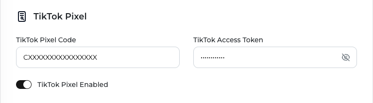

When the TikTok Events API is turned on, ServerMob sends a server-side copy of eligible TikTok Pixel events to TikTok. The browser Pixel request is still forwarded to TikTok unchanged; the server-side call runs in the background and does not delay the page.

## Prerequisites

- ServerMob is serving your GTM container from your subdomain. See [GTM setup](/servermob/gtm-setup).
- Your TikTok Pixel is deployed **as a tag inside GTM**, so its requests go through your subdomain. A Pixel hard-coded in your site's HTML talks to TikTok directly and can't be mirrored.
- Your **TikTok Pixel Code** (the Pixel ID shown in TikTok Events Manager).
- A **TikTok Events API access token** (TikTok Events Manager → your Pixel → **Settings** → **Generate Access Token**).

## Steps

<Steps>
  <Step title="Open TikTok Pixel">
    Open ServerMob from the DAMA panel, select your company and find the **TikTok Pixel** section.
  </Step>
  <Step title="Enter your credentials">
    <ParamField path="TikTok Pixel Code" type="string">
      The code of the Pixel that should receive server-side events.
    </ParamField>
    <ParamField path="TikTok Access Token" type="string">
      The Events API access token generated for that Pixel. Hidden by default; click the eye icon to show it.
    </ParamField>

    The portal lets you save without these fields, but server-side events are only sent when both are filled in.
  </Step>
  <Step title="Turn on TikTok Pixel Enabled">
    Turn on the **TikTok Pixel Enabled** switch. Turn it off to pause server-side events without deleting your Pixel Code and token.
  </Step>
  <Step title="Save">
    Click **Save Changes** and wait for **Settings saved.** See [Saving your settings](/servermob/overview#saving-your-settings) for the other fields the form requires.
  </Step>
</Steps>

<Frame>
  
</Frame>

<Warning>
Treat the access token like a password. Only enter it in the ServerMob portal.
</Warning>

## Which events are sent server-side

ServerMob sends a server-side copy of a browser Pixel event only when **all** of these are true:

1. It is one of these standard events: `Pageview`, `ViewContent`, `ClickButton`, `Search`, `AddToWishlist`, `AddToCart`, `InitiateCheckout`, `AddPaymentInfo`, `PlaceAnOrder`, `CompletePayment`, `CompleteRegistration`, `Contact`, `Subscribe`, `Download`, `SubmitForm`.
2. It carries an **event ID**. Events without one are left to the browser Pixel only, because TikTok couldn't deduplicate the two copies and they would be double-counted. Automatic page views usually have no event ID, so they are not sent server-side.
3. It was sent by the Pixel whose code you entered in the portal. Events from any other TikTok Pixel on the page are ignored.

## What ServerMob sends

Each event is sent to the TikTok Events API with `event_source` set to `web` and your Pixel Code as the event source ID, including these fields when available:

| Field | Source |
|---|---|
| `event`, `event_id`, `event_time` | From the browser Pixel event (same event ID, so TikTok deduplicates) |
| `user.ttp` | The TikTok `_ttp` cookie |
| `user.ttclid` | The `ttclid` click ID from the page URL |
| `user.email`, `user.phone`, `user.external_id` | As sent by the Pixel (already hashed by the Pixel) |
| `user.ip`, `user.user_agent` | The visitor's IP address and browser user agent |
| `page.url`, `page.referrer` | The page URL and referrer |
| `properties.value`, `currency`, `content_type`, `content_id`, `contents` | Commerce properties from the Pixel event |

## Deduplication

TikTok deduplicates browser and server events that share the same event ID. ServerMob reuses the Pixel's event ID and never creates one, so set an event ID on the events you care about (typically commerce events), for example:

```javascript Web
ttq.track('CompletePayment', { value: 49.90, currency: 'EUR' }, { event_id: 'ORDER-10045' });
```

In GTM, map the event ID field of your TikTok tag to a unique value per event.

## Verify

1. Trigger an eligible event with an event ID on your site (for example `AddToCart`).
2. In your browser's **Network** tab, check that the Pixel request goes to `/tiktok/api/v2/pixel` on your subdomain.
3. In TikTok Events Manager, open your Pixel and check that the event shows server-side (Events API) activity in addition to the browser Pixel. Allow a few minutes for events to appear.

## Good to know

- Each event is sent individually. If TikTok rejects an event or the request fails, it is not retried.
- Turning **TikTok Pixel Enabled** off stops server-side events; the browser Pixel keeps working through your subdomain.

## Troubleshooting

See [Troubleshooting](/servermob/troubleshooting#tiktok-events-api).
