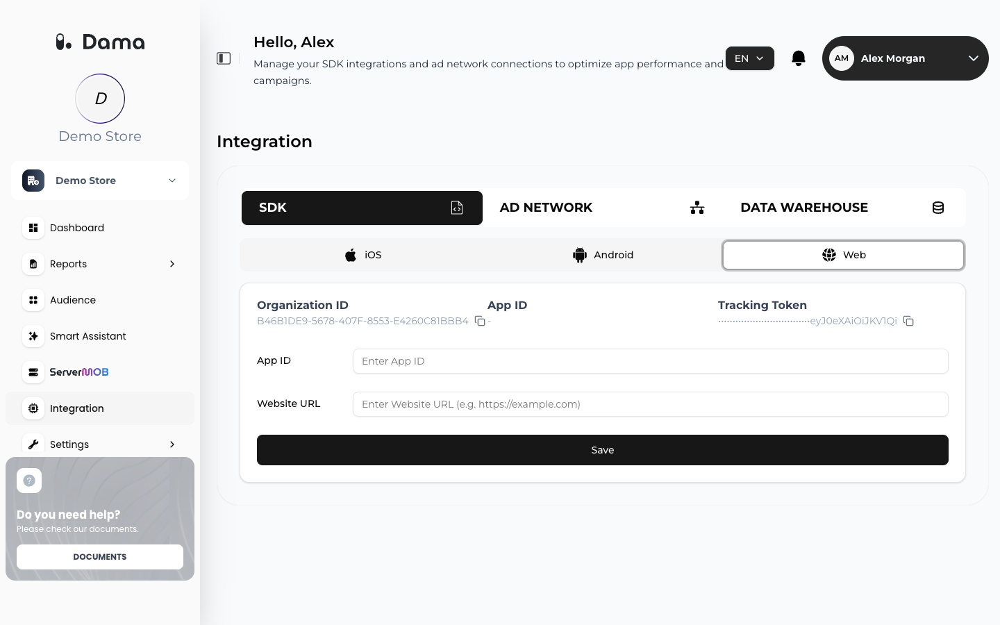

DAMA builds its reports (Dashboard, Funnel Analysis, Retention Analysis, RFM, cLTV) and audiences from the events your website or app sends. Setup has three parts: install the tracking code for your platform, send the events your reports need, and confirm that data is arriving.

## Before you start

- **Organization ID and Tracking Token for each platform.** Each [company](/user-guide/companies) in DAMA has three apps, Web, iOS and Android, and each app has its own Organization ID. In the DAMA panel, open your company and go to **Integration → SDK**. The **Web**, **iOS** and **Android** tabs each show that platform's **Organization ID** and **Tracking Token**, with a **Copy** button. If you don't see **Tracking Token** on a tab, ask your DAMA contact for it.
- **Your collection URL**, provided by DAMA during onboarding. Every event is sent there, and the Web SDK is loaded from it. These docs use `https://collect.example.com` as a placeholder.
- **Access to your site or app code**, or to the tag manager that loads scripts on your site.

<Frame>
  
</Frame>

## Choose your platform

<CardGroup cols={2}>
  <Card title="Web" icon="globe" href="/setup/web">
    Add the DAMA script tag to your website or tag manager. Page views are tracked automatically.
  </Card>
  <Card title="Flutter" icon="mobile" href="/setup/flutter">
    Send events from Dart in a Flutter app for iOS and Android.
  </Card>
  <Card title="iOS" icon="apple" href="/setup/ios">
    Send events from a native iOS app.
  </Card>
  <Card title="Android" icon="android" href="/setup/android">
    Send events from a native Android app.
  </Card>
</CardGroup>

## Then

<CardGroup cols={2}>
  <Card title="Send events" icon="paper-plane" href="/setup/send-events">
    The standard events behind DAMA's reports, plus your own custom events.
  </Card>
  <Card title="Identify users" icon="user" href="/setup/identify-users">
    Link activity to signed-in customers and record their ad consent.
  </Card>
  <Card title="Verify your installation" icon="circle-check" href="/setup/verify-installation">
    Check that events are reaching DAMA.
  </Card>
</CardGroup>

## How data reaches DAMA

Each event is sent as its own HTTPS request, with a JSON body, to `{your collection URL}/tracking/{Organization ID}`, authenticated with the tracking token in the `Authorization` header. The Web SDK sends each event as soon as it is tracked. On mobile, and from your own servers, you send the same requests from your code. See the [field reference](/setup/send-events#field-reference).

<Note>
DAMA never accepts plaintext email addresses, phone numbers or names. The Web SDK hashes these values in the browser before sending them; when you send events yourself, you hash them. See [Identify users](/setup/identify-users).
</Note>
