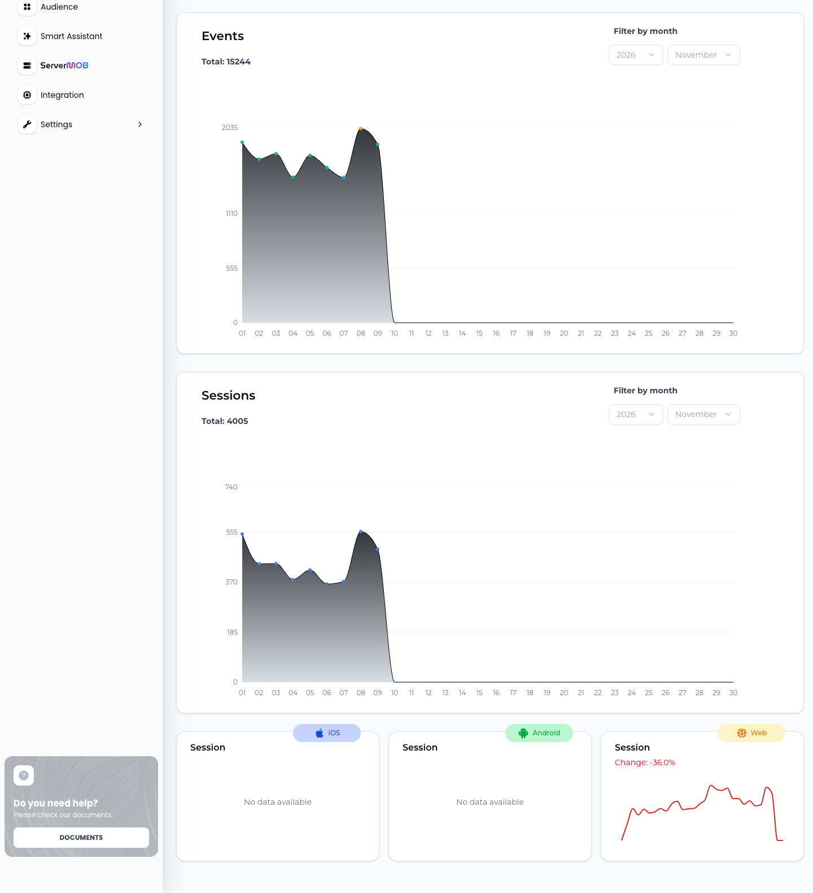

Verify in two places. First check the requests leaving your site or app, which you can see immediately. Then check the DAMA panel, where the Dashboard is calculated once a day, so today's events usually appear there during the following day.

## Prerequisites

- The [Web SDK](/setup/web) is installed, or you are sending events over HTTP from your app or server.
- Access to the DAMA panel for the company you are testing.

## 1. Check the requests

<Tabs>
  <Tab title="Web">
    <Steps>
      <Step title="Open the Network tab">
        Open your site, open the browser's developer tools, and go to the **Network** tab. Filter by `tracking`.
      </Step>
      <Step title="Reload the page">
        A `POST` request to `https://collect.example.com/tracking/YOUR_ORGANIZATION_ID` (with your collection URL) should appear right away. Its payload has `"event_name": "page_view"`. If the request goes to a different address, see [When to call damaDP](/setup/web#when-to-call-damadp).
      </Step>
      <Step title="Check the response">
        A successful request returns status `202` with the body `{"success": true}`. For any other status, see [Responses](/setup/send-events#responses).
      </Step>
      <Step title="Trigger your own events">
        Add a product to the cart, or do anything else you track, and confirm that a request appears with the expected `event_name`, `event_cart_value` and `event_currency`. On a page where you are signed in, check that the payload contains `user_email_hash` and no plaintext `user_email`, and that it contains `session_dcp` if you send [consent](/setup/identify-users#consent).
      </Step>
    </Steps>

    You can also check the SDK from the browser console:

    ```javascript
    // Has the SDK started?
    damaDP.getTracker().getStatus();
    // → { isInitialized: true, isRunning: true, ... }

    // Print detailed SDK logs (prefixed with [DamaTracker:...]) to the console
    damaDP('config', { logLevel: 'DEBUG' });
    ```

    <Note>
    Only requests whose payload contains an `event_name` are events. When a tab is hidden or closed, and about a minute into a page visit, the SDK also sends a session summary request without an `event_name`. Those requests can show a different status; you can ignore them.
    </Note>
  </Tab>
  <Tab title="Apps and HTTP">
    Send one test event and check the response:

    ```bash
    curl -i -X POST "https://collect.example.com/tracking/YOUR_ORGANIZATION_ID" \
      -H "Authorization: YOUR_TRACKING_TOKEN" \
      -H "Content-Type: application/json" \
      -d '{"event_name": "page_view", "event_time": 1760947200000, "event_page_path": "/install-test"}'
    ```

    Expect `HTTP/1.1 202` and `{"success": true}`. Use a current timestamp in milliseconds for `event_time`. Timestamps more than 24 hours in the future, or earlier than 2020, are rejected.

    In your app, log the status code of every request while testing. Anything other than `202` means the event was not stored; see [Responses](/setup/send-events#responses).
  </Tab>
</Tabs>

## 2. Check the DAMA panel

<Steps>
  <Step title="Open the Dashboard">
    In the DAMA panel, open the company whose Organization ID you are sending to. The **Dashboard** opens.
  </Step>
  <Step title="Check the Events chart">
    The **Events** chart shows the total number of events received. Pick the current year and month with **Filter by month**. Your test events, including custom events, count toward this total once the day has been calculated.
  </Step>
  <Step title="Check sessions and pages">
    The **Sessions** chart shows session counts, and the **Session** cards for **iOS**, **Android** and **Web** show each platform's sessions. The **Page** table lists the most viewed page paths from your `page_view` events.
  </Step>
</Steps>

<Frame>
  
</Frame>

<Info>
Dashboard figures are calculated once a day, per calendar day in UTC, so a day's events usually appear during the following day. Your requests can succeed well before the numbers change. RFM and cLTV need `purchase` events and are recalculated about once a day.
</Info>

## Troubleshooting

<AccordionGroup>
  <Accordion title="Requests succeed but the Dashboard stays empty">
    The Dashboard is calculated once a day, so check again the next day. Check that you opened the company whose Organization ID you are sending to, and that the Organization ID in your installation matches the one under **Integration → SDK**. Events need `session_id` and `session_start_time` to count as sessions.
  </Accordion>
  <Accordion title="Revenue is missing or looks wrong">
    Check that `purchase` events have a numeric value and a three-letter currency code. Revenue is converted for TRY, USD, EUR and GBP. See [Purchase: value and currency](/setup/send-events#purchase-value-and-currency).
  </Accordion>
  <Accordion title="Retention Analysis shows no cohorts">
    Cohorts are built from `session_start` events. The Web SDK doesn't send them automatically. See [Session start](/setup/send-events#session-start).
  </Accordion>
  <Accordion title="Status 401, 413, 422, 429 or 503">
    See [Responses](/setup/send-events#responses) for what each status means and what to do.
  </Accordion>
</AccordionGroup>

## Next steps

<CardGroup cols={2}>
  <Card title="Read your Dashboard" icon="gauge" href="/user-guide/dashboard" />
  <Card title="Build audiences" icon="users" href="/user-guide/audiences" />
  <Card title="Connect Google Ads or Meta" icon="plug" href="/integrations/overview" />
  <Card title="Set up ServerMob" icon="server" href="/servermob/overview" />
</CardGroup>
