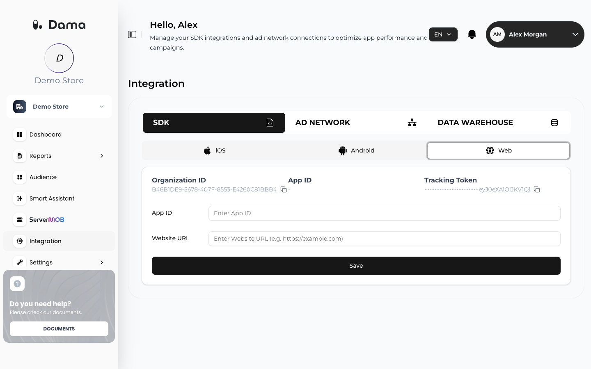

The DAMA Web SDK is one JavaScript file that you load with a script tag from your collection URL. When it loads, it starts a session, sends a `page_view` event, and exposes a global `damaDP()` function that you call to send ecommerce and custom events.

## Prerequisites

- Your Web app's **Organization ID** and **Tracking Token**. In the DAMA panel, open your company and go to **Integration → SDK → Web**, then use **Copy** next to each value. If you don't see **Tracking Token** on this tab, ask your DAMA contact for it.
- Your collection URL, provided by DAMA during onboarding. The examples on this page use `https://collect.example.com`.
- Your site must be served over HTTPS. The SDK uses the browser's Web Crypto API to hash user details, and browsers only offer it on secure pages.

<Frame>
  
</Frame>

## Install

<Steps>
  <Step title="Add the script tag">
    Put this tag in the `<head>` of every page, before any code that calls `damaDP()`. Replace the placeholders with your own values.

    <CodeGroup>
    ```html HTML
    <script src="https://collect.example.com/sdk/dama.js?id=YOUR_ORGANIZATION_ID&token=YOUR_TRACKING_TOKEN&collect=https://collect.example.com"></script>
    ```
    ```html Google Tag Manager (Custom HTML tag)
    <!-- Trigger: All Pages. Fire this tag before any tag that calls damaDP(). -->
    <script src="https://collect.example.com/sdk/dama.js?id=YOUR_ORGANIZATION_ID&token=YOUR_TRACKING_TOKEN&collect=https://collect.example.com"></script>
    ```
    </CodeGroup>

    The script is served from your collection URL at `/sdk/dama.js`. The SDK reads its settings from the script URL:

    <ParamField query="id" type="string" required>
      Your Organization ID. Without it the SDK does not start.
    </ParamField>
    <ParamField query="token" type="string" required>
      Your tracking token. The SDK sends it in the `Authorization` header with every event. Without it, events are rejected with `401`.
    </ParamField>
    <ParamField query="collect" type="string" required>
      Your collection URL, with no trailing path. Events are posted to `{collect}/tracking/{id}`. Always include it: without it the SDK sends events to a default address instead of your collection URL, and they never reach your reports. If the URL contains `&` or other special characters, URL-encode it.
    </ParamField>
    <ParamField query="consents" type="string">
      The visitor's consent choices as comma-separated `true`/`false` values in this order: essential, ads, analytics. Example: `consents=true,true,false`. Needed if you want to send audiences to Google Ads. See [Consent](/setup/identify-users#consent).
    </ParamField>
  </Step>
  <Step title="Send ecommerce and custom events">
    Call `damaDP()` from your page code. Follow [When to call damaDP](#when-to-call-damadp) below.

    ```javascript
    damaDP('add_to_cart', {
      value: 1499.9,
      currency: 'TRY',
      items: [{ item_id: 'SKU-123', item_name: 'Running Shoe', price: 1499.9, quantity: 1 }]
    });

    damaDP('event', 'newsletter_signup', { form_location: 'footer' });
    ```

    See [Send events](/setup/send-events) for the full list of standard events and the fields DAMA's reports read. If you use Retention Analysis, also add the [session start snippet](/setup/send-events#session-start).
  </Step>
  <Step title="Identify signed-in users">
    After login or signup, pass the customer's details so their activity is tied to one person across sessions and devices. See [Identify users](/setup/identify-users).
  </Step>
  <Step title="Verify">
    Follow [Verify your installation](/setup/verify-installation) to confirm that requests succeed and data appears in the DAMA panel.
  </Step>
</Steps>

## When to call damaDP

Call `damaDP()` only **after the page's HTML has been parsed**. With the script tag in `<head>`, the SDK starts when the browser fires `DOMContentLoaded`. A call made from a script that runs earlier, for example an inline `<script>` in the page body, makes the SDK start too early, and it then can't read the `collect` setting from its script tag.

Wrap calls that run while the page is loading in a small helper:

```html
<script>
  function damaReady(callback) {
    if (document.readyState === 'loading') {
      document.addEventListener('DOMContentLoaded', callback);
    } else {
      callback();
    }
  }

  // Example: order confirmation page
  damaReady(function () {
    damaDP('purchase', {
      transaction_id: 'ORDER-1001',
      event_transaction_id: 'ORDER-1001',
      value: 2499.9,
      currency: 'TRY'
    });
  });
</script>
```

Code that runs later, such as click handlers, single-page-app code and Google Tag Manager tags fired after the DAMA tag, can call `damaDP()` directly.

<Warning>
`damaDP` exists only after the script has loaded. If you call it before that, for example from a tag that fires before the DAMA tag, the browser throws a `ReferenceError` and the event is lost. Load the script synchronously (without `async` or `defer`) in `<head>`. Calls made after the script has loaded but before the SDK has finished starting are queued and sent automatically. Queued calls must use a known command (`event`, the ecommerce event names, `userData`, `userDataPush` or `config`); use `damaDP('event', 'your_event')` for custom events.
</Warning>

## What the SDK collects automatically

| What | Details |
|---|---|
| `page_view` event | Sent once the SDK starts, and again on every in-page navigation in single-page apps (History API `pushState`/`replaceState`, back/forward and hash changes). Includes the page URL, path and title. |
| Session | A session ID (a cookie that expires after 30 minutes without activity), session start time, and the session's end time and duration. |
| Visitor ID | A random ID in a first-party cookie, used to recognize the same browser across sessions. |
| Device and browser | Device type, screen resolution, mobile flag, browser, OS version and timezone. |
| Acquisition | Landing page URL, referrer, `utm_source`, `utm_medium`, `utm_campaign`, `utm_content`, `gclid`, and a channel taken from a `channel` URL parameter or worked out from the referrer. |

The SDK does not look up or send the visitor's IP address, and it does not send the user agent string. Like any web request, the request to your collection URL reveals the visitor's IP address to the server; DAMA does not store it. Plaintext email, phone and name fields are hashed in the browser and removed before sending (see [Identify users](/setup/identify-users)).

<Note>
The Web SDK does not send a `session_start` event. Retention Analysis builds its cohorts from `session_start`, so add the [session start snippet](/setup/send-events#session-start) if you use Retention Analysis.
</Note>

## Command reference

| Call | What it does |
|---|---|
| `damaDP('event', name, params)` | Sends an event called `name` with optional `params`. |
| `damaDP('view_item', params)` | Shortcut for the standard ecommerce events. The same form works for `view_item_list`, `add_to_cart`, `view_cart`, `begin_checkout`, `purchase` and `view_promotion`. |
| `damaDP('any_other_name', params)` | Once the SDK has started, any command it doesn't recognize is sent as a custom event with that name. |
| `damaDP('userData', user)` | Attaches user details to the following events on the current page. |
| `damaDP('userDataPush', user)` | Like `userData`, but also saves the details in a first-party cookie so they apply on later page loads. |
| `damaDP('config', options)` | Changes SDK settings at runtime, for example `{ logLevel: 'DEBUG' }` to print debug logs to the console. |
| `damaDP.getTracker()` | Returns the running tracker instance, for debugging. For example, `damaDP.getTracker().getStatus()` tells you whether the SDK has started. |

## Cookies and storage

All cookies are first-party cookies on your own domain.

| Name | Type | Lifetime | Purpose |
|---|---|---|---|
| `dama_cookie_id` | Cookie | 7 days, renewed on activity | Visitor ID for this browser. |
| `damadp_session_id` | Cookie | 30 minutes, renewed on activity | Current session ID. |
| `damadp_user_data` | Cookie | 365 days | User details. Email, phone and name are stored only as SHA-256 hashes. |
| `dama_consents` | Cookie | 365 days | Consent flags from the `consents` parameter. |
| `damadp_session_data` | sessionStorage | Browser tab | Session details for the current tab. |

## Troubleshooting

<AccordionGroup>
  <Accordion title="No requests are sent at all">
    Check that the script URL includes `id=`. Without it the SDK does not start. Then make sure no content security policy or ad blocker is blocking the script or your collection URL.
  </Accordion>
  <Accordion title="Requests go to a different address than your collection URL">
    The script URL is missing `collect=`, or `damaDP()` was called before the page's HTML was parsed. See [When to call damaDP](#when-to-call-damadp).
  </Accordion>
  <Accordion title="Requests fail with 401">
    The `token` parameter is missing, or it doesn't belong to the Organization ID in `id`. Check both values on **Integration → SDK → Web**.
  </Accordion>
  <Accordion title="Requests fail with 422">
    The event failed validation. Common causes: a `currency` that isn't a three-letter code (for example `TL` instead of `TRY`), more than 40 custom parameters, or a parameter value nested too deeply. See [Send events](/setup/send-events#custom-events) and the [field reference](/setup/send-events#field-reference).
  </Accordion>
  <Accordion title="The same event appears to be skipped">
    The SDK drops an event that repeats another one within half a second, to avoid accidental double-firing. Two events count as the same when they have the same name, the same page URL and the same `item_id`, `transaction_id` and `promotion_id` parameters (other parameters, including `items`, are not compared).
  </Accordion>
  <Accordion title="Nothing is sent from a Shopify custom pixel">
    The SDK deliberately sends nothing when the page URL contains `web-pixels`.
  </Accordion>
</AccordionGroup>
