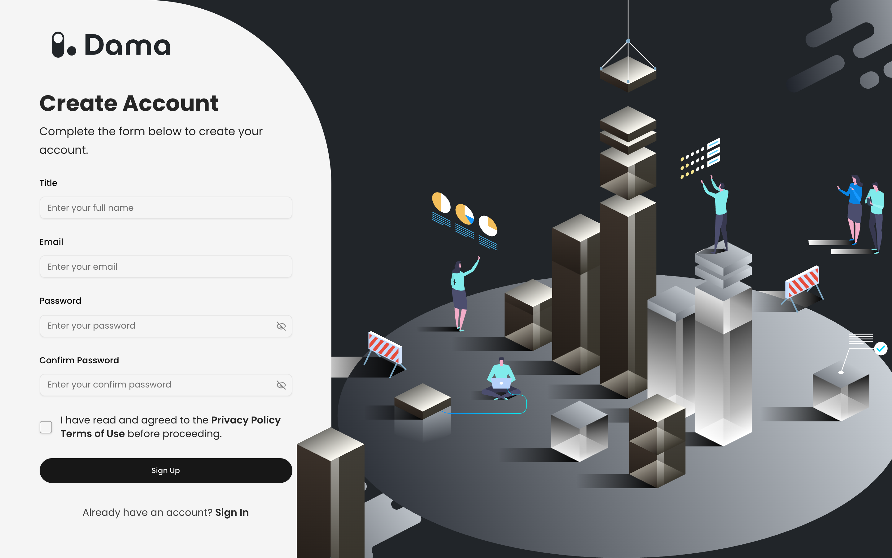
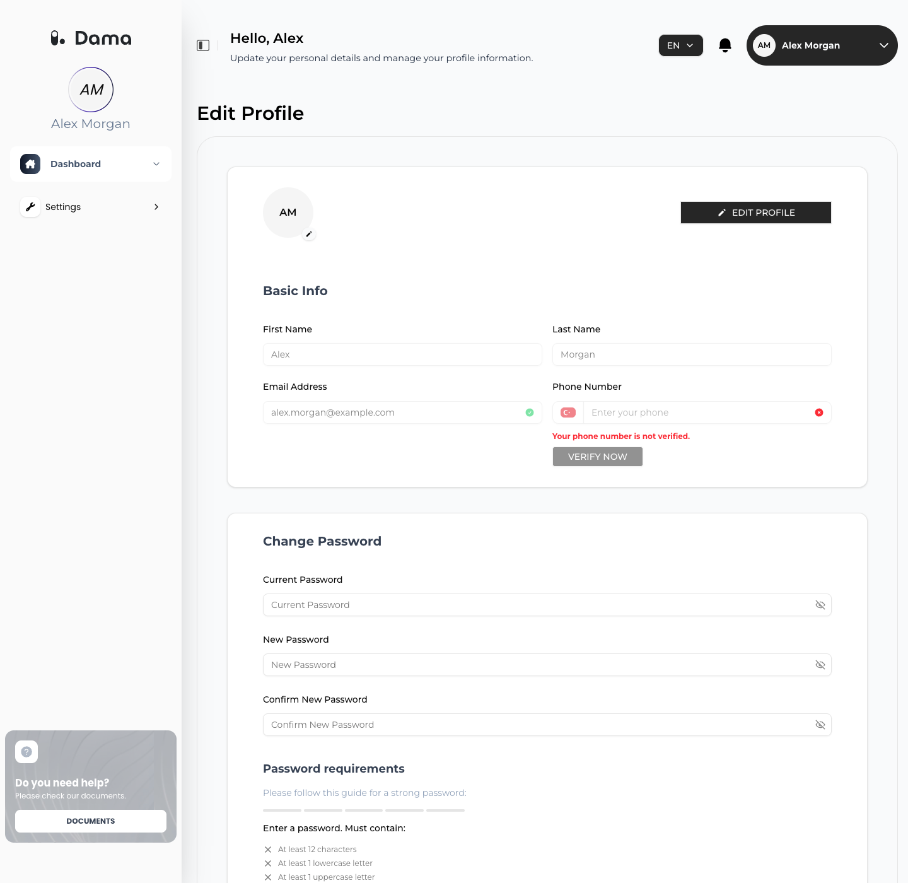

Your DAMA account is the email address and password you use to sign in to the DAMA panel. One account can work in several companies: the ones you create and the ones you're invited to. See [Companies and apps](/user-guide/companies).

## Password rules

The same rules apply when you sign up, accept an invitation, reset your password or change it in your profile. A password must have:

- at least 12 characters
- at least one uppercase letter and one lowercase letter
- at least one number
- at least one special character, such as `!`, `?` or `#`

## Create an account

<Steps>
  <Step title="Open the sign-up form">
    Go to the DAMA panel and click **Sign Up** under *Don't have an account?*. The form is titled **Create Account**.
  </Step>
  <Step title="Fill in your details">
    Enter your full name in **Title** (at least 4 characters), your **Email**, a **Password** and the same password again in **Confirm Password**. See [Password rules](#password-rules).
  </Step>
  <Step title="Accept the terms">
    Tick the checkbox to confirm that you have read and agreed to the **Privacy Policy** and **Terms of Use**, then click **Sign Up**.
  </Step>
  <Step title="Verify your email">
    DAMA sends a 6-digit verification code to your email address. On the **Email Verification** screen, enter the code and click **Verify**. You can also click the verification link in the same email instead of entering the code.

    The code and the link are valid for 15 minutes.
  </Step>
  <Step title="Sign in">
    After verification you see *Email verified successfully. Please sign in to continue.* Sign in with your email and password.
  </Step>
</Steps>

<Frame>
  
</Frame>

If you see *This email is already registered*, the address already has a DAMA account. Sign in instead, or [reset the password](#reset-your-password).

A new account has no companies yet. After you sign in, add your first company from the company list. See [Add a company](/user-guide/companies#add-a-company).

## Sign in

On the **Welcome!** screen, enter your **E-mail** and **Password** and click **Sign In**. You land on the company list.

If you see *Email address or password is incorrect.*, check your details or [reset your password](#reset-your-password).

For security, a session lasts 3 hours. After that, the panel asks you to sign in again.

## Reset your password

<Steps>
  <Step title="Request a code">
    On the sign-in screen, click **Forgot password?**. Enter your **Email** and click **Submit**.
  </Step>
  <Step title="Enter the code">
    If an account exists for that address, DAMA emails it a 6-digit code. On the **Verify Code** screen, enter the code. If it doesn't arrive, wait for the countdown to finish and click **Resend Code**.

    You can also open the link in the email; it fills in the code for you.
  </Step>
  <Step title="Choose a new password">
    On **Create New Password**, enter the new **Password** and **Confirm Password** (see [Password rules](#password-rules)) and click **Reset Password**. You see *Password reset successfully* and can sign in with the new password.
  </Step>
</Steps>

The code is valid for 30 minutes and stops working after too many wrong attempts. If you see *Invalid or expired verification code*, request a new code.

## Accept an invitation

When someone invites you to a company in DAMA and you don't have an account yet, you receive an invitation email. Its link opens the **Accept Invitation** screen.

<Steps>
  <Step title="Fill in your details">
    Enter your **Full Name** (at least 4 characters), the **Email** address the invitation was sent to, a **Password** and **Confirm Password** (see [Password rules](#password-rules)).
  </Step>
  <Step title="Accept">
    Tick the checkbox to accept the Privacy Policy and Terms of Use and click **Accept Invitation**.
  </Step>
  <Step title="Verify your email and sign in">
    Enter the 6-digit code from the verification email and click **Verify**, then sign in. The company you were invited to appears in your company list.
  </Step>
</Steps>

<Warning>
  An invitation link works once and expires after **24 hours**. If you see *Invalid or expired invitation token. Please request a new invitation.*, ask the person who invited you to send a new invitation.
</Warning>

If you already have a DAMA account, you don't need to accept anything: the company is added to your account right away, and you receive an email with a link to sign in.

## Your profile

Open the user menu (your name in the top-right corner) and choose **Edit Profile**.

<Frame>
  
</Frame>

### Change your name

1. Click **EDIT PROFILE**.
2. Change **First Name** and **Last Name**. Each can be up to 100 characters and may contain only unaccented letters (A–Z), numbers and spaces.
3. Click **SAVE**. You see *Profile updated successfully*. Click **CANCEL** to discard your changes.

**Email Address** and **Phone Number** are shown for reference and can't be changed here. Next to your email you can see whether it has been verified.

### Change your password

1. Under **Change Password**, enter your **Current Password**.
2. Enter a **New Password** and repeat it in **Confirm New Password**. The **Password requirements** list shows which [rules](#password-rules) the new password already meets. The new password must be different from your current one.
3. Click **UPDATE PASSWORD**. You see *Password changed successfully*.

If you see *Invalid current password*, the current password you entered is wrong.

## Change the language

The panel is available in English and Turkish. Click the language button in the top bar (for example **EN**) and choose **English** or **Türkçe**. The panel switches immediately. Your choice is remembered in this browser.

## Sign out

Open the user menu and choose **Log out**, then confirm with **Logout**.
