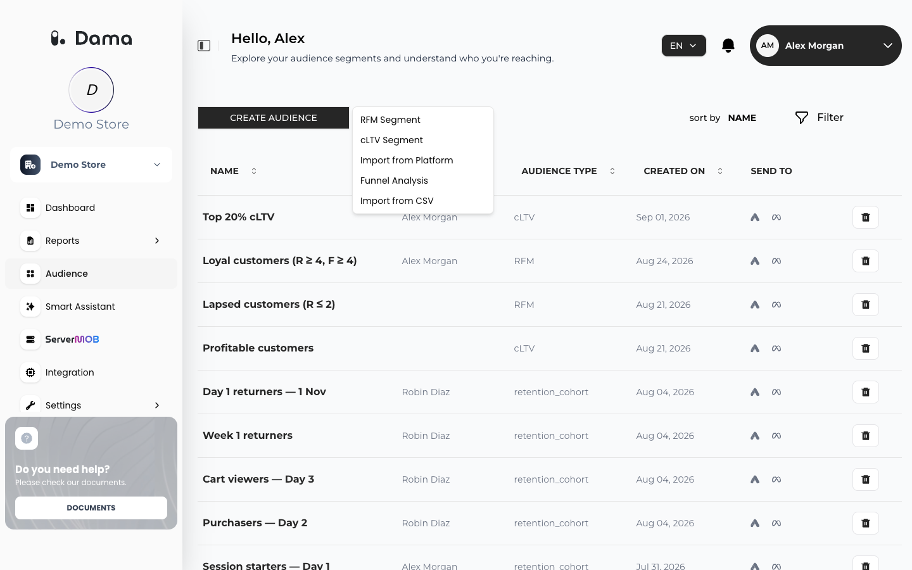
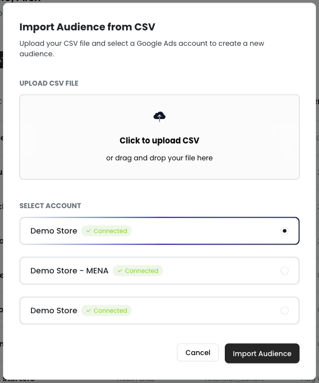

An **audience** is a saved list of users. You create audiences from DAMA reports (for example, an RFM score range or a group of retention cells) and send them to your ad accounts for targeting. All audiences of the company are listed on the **Audience** screen.

Go to **Audience** in the left menu.

<Frame>
  
</Frame>

## Ways to create an audience

| Source | Where | Who is in the audience |
| --- | --- | --- |
| [RFM](/user-guide/rfm#create-an-audience-from-score-ranges) | **Reports → RFM** | Customers whose R, F and M scores fall in the ranges you set |
| [cLTV](/user-guide/cltv#create-an-audience-from-a-cltv-range) | **Reports → cLTV** | Customers whose cLTV is in the range you set |
| [Retention Analysis](/user-guide/retention#create-an-audience-from-cells) | **Reports → Retention Analysis**, select heatmap cells, then **Make Audience** | Users in the selected cohort cells |
| CSV file | **Audience → CREATE AUDIENCE → Import from CSV** or **Import from Platform** | The email addresses in your file, uploaded directly to an ad account. See [Import an audience from a CSV file](#import-an-audience-from-a-csv-file). |

The **CREATE AUDIENCE** menu on the Audience screen also has shortcuts: **RFM Segment** opens RFM and **cLTV Segment** opens cLTV.

<Note>
  Report-based audiences (RFM, cLTV, Retention Analysis) are a snapshot of the users who matched when you created them. They do not update automatically when new data arrives. Create a new audience to get a fresh list.
</Note>

## The audience list

| Column | Meaning |
| --- | --- |
| **NAME** | The audience name. Hover over it to see the full name and a copy button. |
| **CREATED BY** | The team member who created it |
| **AUDIENCE TYPE** | Where the audience comes from: **RFM**, **cLTV**, or a short code for other sources, such as `retention_cohort` for Retention Analysis and `customer_match` for CSV imports |
| **CREATED ON** | Creation date |
| **SEND TO** | A Google Ads icon and a Meta icon to send the audience |

The list shows 10 audiences per page; use **Previous** and **Next** to move between pages.

### Sort and filter

- **sort by**: choose **NAME**, **CREATED BY**, **AUDIENCE TYPE** or **CREATED ON**, then use the arrow button to switch between ascending and descending.
- **Filter**: choose a column, an operator (**Contains**, **Equals**, **Starts with**, **Ends with**) and a **Value**, and optionally a **Start Date** and **End Date**. Click **Apply**, or **Clear** to reset.

### Delete an audience

Click the delete icon at the end of the row, then click **Delete** in the **Are you sure?** dialog. Deleting removes the audience from DAMA; lists you already sent to Google Ads or Meta stay in those platforms.

## Send an audience to an ad platform

You need a linked ad account first: see [Google Ads](/integrations/google-ads) or [Meta](/integrations/meta).

<Steps>
  <Step title="Click the platform icon">
    In the **SEND TO** column, click the Google Ads or Meta icon of the audience.
  </Step>
  <Step title="Select the account">
    In **Send Audience**, choose the account under **TARGET AUDIENCE**.
  </Step>
  <Step title="Send">
    Click **Send**.
  </Step>
</Steps>

What happens next:

- DAMA keeps the users in the audience who are identified by a hashed email address (`user_email_hash`) and uploads only those SHA-256 hashes. Users DAMA only knows by an anonymous ID are not sent.
- **Google Ads**: only users whose most recent recorded consent grants **ads** consent are sent. A new Customer Match list with the audience's name is created, with a 180-day membership duration.
- **Meta**: every user with an email hash is sent; DAMA does not filter by ad consent for Meta. A new Custom Audience with the audience's name is created.
- The upload happens once. The list in the ad platform is not updated later.

See [Google Ads](/integrations/google-ads#what-dama-sends) and [Meta](/integrations/meta#what-dama-sends) for details and troubleshooting.

<Warning>
  Ad platforms can only match users DAMA has an email hash for. If your apps don't identify signed-in users with `user_email_hash`, sending fails because the audience has no one to upload. See [Identify users](/setup/identify-users) and, for Google Ads, [Consent](/setup/identify-users#consent).
</Warning>

## Import an audience from a CSV file

**Import from CSV** and **Import from Platform** do the same thing: they upload a CSV file of email addresses straight to one of your linked ad accounts and add the result to the audience list. **Import from CSV** shows everything in one dialog; **Import from Platform** walks you through two steps, **Select Account** and then **Upload CSV**.

<Tabs>
  <Tab title="Import from CSV">
    1. Click **CREATE AUDIENCE → Import from CSV**.
    2. Under **UPLOAD CSV FILE**, click **Click to upload CSV** or drag the file into the box.
    3. Under **SELECT ACCOUNT**, choose the account to upload to.
    4. Click **Import Audience**.
  </Tab>
  <Tab title="Import from Platform">
    1. Click **CREATE AUDIENCE → Import from Platform**.
    2. Under **Select Account**, choose the account to upload to and click **Next**.
    3. Click **Click to upload CSV** or drag the file into the box.
    4. Click **Import Audience**.
  </Tab>
</Tabs>

<Frame>
  
</Frame>

The file must be a `.csv` file of up to 8 MB and 200,000 rows, with a header row. The required columns depend on the account you choose:

| Platform | Required columns |
| --- | --- |
| Google Ads | `email` and `ads_consent`. Only rows with granted consent (`true`, `1`, `yes`, `granted`, `consent_granted`) are uploaded. |
| Meta | `email` |

The `email` column can hold plain email addresses or their SHA-256 hashes. DAMA hashes plain addresses before upload, so only hashes reach the ad platform. See [Google Ads](/integrations/google-ads#import-a-list-from-a-csv-file) and [Meta](/integrations/meta#import-a-list-from-a-csv-file) for the details.

The audience is named after the file name, without the extension. You can't import two files with the same name within one day. An imported audience already lives in the ad account you chose; the **SEND TO** icons are for audiences built from DAMA reports.
