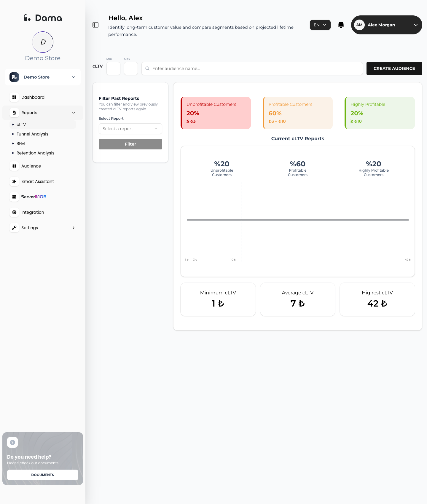

**cLTV** estimates the lifetime value of each purchasing customer and shows how that value is distributed across your customer base. You can create an audience from any cLTV range.

Go to **Reports → cLTV**.

<Frame>
  
</Frame>

## What cLTV needs

cLTV is built from `purchase` events with a purchase value from the last **6 months** (180 days). Customers without a purchase in that window are not included. A customer is a DAMA user, identified or anonymous (see [Identify users](/setup/identify-users)).

cLTV is calculated separately for each app (Web, iOS, Android) of the company, and the results are shown together.

## The formula

DAMA uses a simple, transparent model. First it calculates a few numbers for all customers of the app over the 6-month window:

```text Company-level inputs
repeat rate          = customers with 2 or more purchases ÷ all customers
monthly churn        = 1 − repeat rate
expected lifespan    = min(12, 1 ÷ monthly churn)          (in months)
```

Then, for each customer:

```text Customer cLTV
average order value  = customer's total revenue ÷ customer's number of purchases
purchase frequency   = customer's number of purchases ÷ 6       (purchases per month)
value per month      = average order value × purchase frequency
cLTV                 = value per month × expected lifespan
```

Notes:

- A "purchase" is counted once per session: several `purchase` events in the same session count as one purchase, while all of their value counts toward revenue.
- The expected lifespan is the same for every customer of an app and is capped at **12 months**. The more of your customers buy again, the longer the lifespan.
- Because value per month × 6 equals the customer's revenue in the window, cLTV is the customer's 6-month revenue scaled by expected lifespan ÷ 6.

### Worked example

Your customers in the last 6 months: 1,000 customers, 250 of them bought at least twice.

- Repeat rate = 250 ÷ 1,000 = 0.25, monthly churn = 0.75, expected lifespan = 1 ÷ 0.75 ≈ 1.33 months.
- A customer with 3 purchases totalling 300: average order value = 100, purchase frequency = 3 ÷ 6 = 0.5, value per month = 50, **cLTV ≈ 50 × 1.33 ≈ 67**.

## How to read the screen

**Current cLTV Reports** shows the distribution of cLTV values: the horizontal axis is cLTV and the curve shows how many customers have each value (a smoothed curve). Only customers with a cLTV above zero are included.

Customers are split by percentile:

| Group | Share of customers | cLTV range |
| --- | --- | --- |
| **Unprofitable Customers** | Lowest 20% | Up to the 20th percentile |
| **Profitable Customers** | Middle 60% | Between the 20th and 80th percentiles |
| **Highly Profitable** | Top 20% | From the 80th percentile up |

The three cards above the chart show each group's share and its cLTV range (for example *≤ ₺3*, *₺3 – ₺10*, *≥ ₺10*). Below the chart, **Minimum cLTV**, **Average cLTV** and **Highest cLTV** summarize all customers with a cLTV above zero.

<Note>
  cLTV adds up purchase values exactly as you sent them, without currency conversion. The screen shows a **₺** sign whatever currency your purchases use, so read the amounts in the currency of your purchases, and send all purchases of an app in the same currency. See [Purchase: value and currency](/setup/send-events#purchase-value-and-currency).
</Note>

The first time you open the screen, DAMA creates the initial report automatically (*Preparing the initial cLTV report*).

## Create an audience from a cLTV range

<Steps>
  <Step title="Set the range">
    Next to **cLTV**, enter a **Min** and/or **Max** value (0 or more). **Max** must be greater than or equal to **Min**.
  </Step>
  <Step title="Name the audience">
    Type a name in the *Enter audience name...* field.
  </Step>
  <Step title="Create">
    Click **CREATE AUDIENCE**. The audience contains the customers whose cLTV is between Min and Max (inclusive), and **Filtered cLTV Reports** shows its distribution.
  </Step>
</Steps>

Enter at least a name, a Min or a Max; otherwise you see *Please enter at least one filter criterion*.

<Tip>
  Use the ranges shown on the group cards. For example, to target your **Highly Profitable** customers, set **Min** to the value on that card.
</Tip>

If no customer falls in the range, the audience is still created and you see *Audience created successfully (No data found)*.

The audience appears on the [Audience](/user-guide/audiences) screen.

### View a past report

Under **Filter Past Reports**, choose a report in **Select Report** and click **Filter** to see its distribution again.

## How often cLTV is updated

DAMA recalculates cLTV about once a day when new purchases have arrived since the last calculation.

If your [Report data source](/integrations/bigquery#report-data-source) is **BigQuery**, cLTV is calculated from your GA4 export once a week (Thursday night), and on the first night after you change the source. Values then come from GA4's USD purchase values.

## Limitations

- The model does not predict each customer's future behavior; it scales recent revenue by an app-wide lifespan.
- Costs and margins are not included, so "Unprofitable" means "lowest value", not a loss.
- With few repeat customers, the expected lifespan is short (at least 1 month), and cLTV values stay close to the customers' recent revenue ÷ 6.
