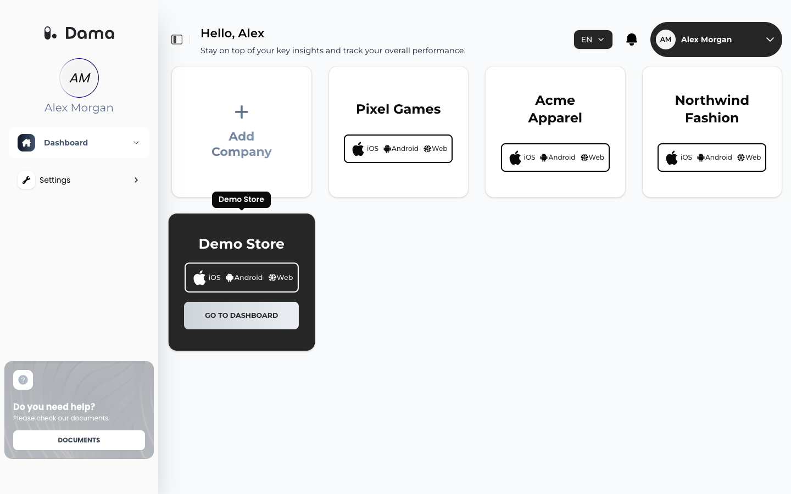
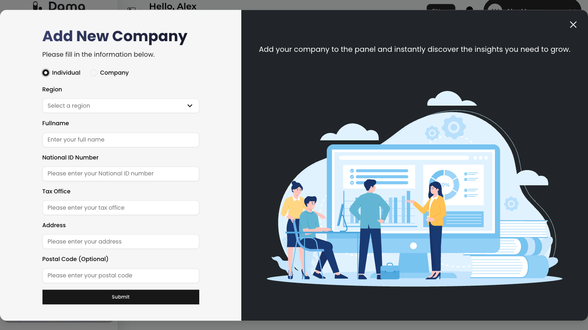
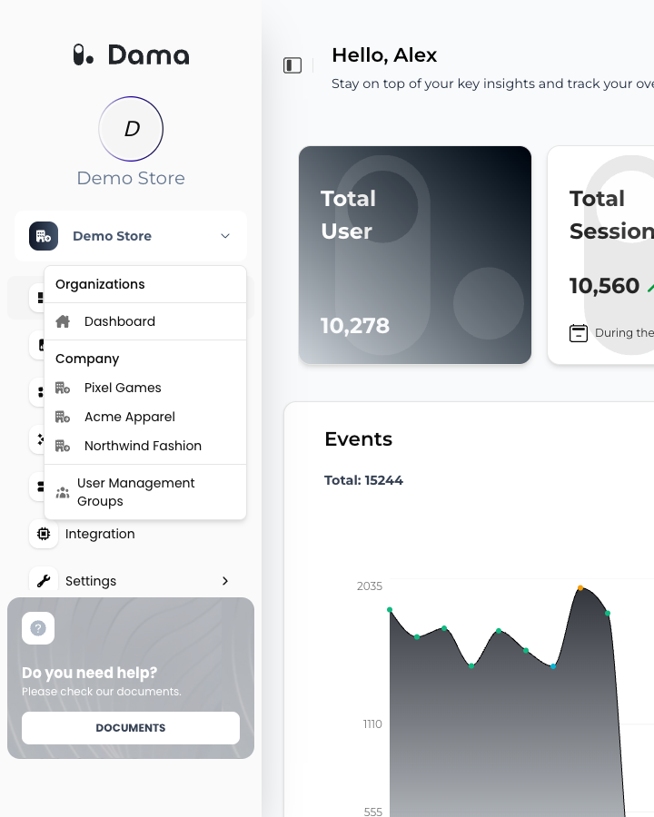

In DAMA, everything you track and analyze belongs to a **company**. Each company has three apps, **Web**, **iOS** and **Android**, and each app has its own **Organization ID** that you use when you install tracking. Reports, audiences, integrations and team members are set up per company.

## Your company list

After you sign in, you see your company list. It shows every company you are an active member of: the ones you created and the ones you were invited to.

<Frame>
  
</Frame>

Each card shows the company name and its apps (**iOS**, **Android**, **Web**). To open a company, hover over its card and click **GO TO DASHBOARD**.

If a company you expect is missing, ask its owner to check that you are a member and that your status is **Active**. See [Team and permissions](/user-guide/team-and-permissions).

## Add a company

<Steps>
  <Step title="Open the dialog">
    On the company list, click **Add Company**. The **Add New Company** dialog opens.
  </Step>
  <Step title="Choose the type">
    Choose **Individual** if you track your own business as a person, or **Company** for a registered business.
  </Step>
  <Step title="Choose a region">
    In **Region**, choose where DAMA stores and processes this company's data: **Europe**, **North America** or **Asia**. Only the regions currently available are listed.

    <Warning>
      The region can't be changed after the company is created.
    </Warning>
  </Step>
  <Step title="Fill in the details">
    | Individual | Company | Rule |
    | --- | --- | --- |
    | **Fullname** | **Title** | At least 4 characters (Fullname) or 2 characters (Title) |
    | **National ID Number** | **Tax Number** | At least 10 characters |
    | **Tax Office** | **Tax Office** | At least 4 characters |
    | **Address** | **Address** | At least 4 characters |
    | **Postal Code (Optional)** | **Postal Code (Optional)** | |
  </Step>
  <Step title="Submit">
    Click **Submit**. You see *Company created successfully* (or *Individual created successfully*) and the new company appears in your list.
  </Step>
</Steps>

<Frame>
  
</Frame>

If you see *This organization group is already available*, a company with the same name, tax number and postal code already exists. If it's yours and you can't see it, ask its owner to invite you.

### What DAMA creates

A new company comes with three apps: **Web**, **iOS** and **Android**. Each app has its own **Organization ID**, shown on the matching tab under **Integration → SDK**. Send your website's events to the Web app and your mobile apps' events to the iOS and Android apps. See [Setup overview](/setup/overview).

You are added to the company as its first member, and you can invite your team from **Settings → User Management**. See [Team and permissions](/user-guide/team-and-permissions).

<Tip>
  After creating the company, open **Settings → Company Profile** and set **Sector / Industry**. If it's **E-Commerce** or **Finance**, the Dashboard also shows revenue and conversions. See [Company profile](/user-guide/company-profile).
</Tip>

## Switch between companies

The company menu sits in the sidebar, under your name. It shows the name of the company you're working in.

1. Click the company menu.
2. Under **Company** (or **Individual**), choose another company.

If you're on a company screen, such as **Funnel Analysis**, the same screen opens for the company you chose. Otherwise its **Dashboard** opens.

To go back to your company list, open the company menu and choose **Dashboard** under **Organizations**.

<Frame>
  
</Frame>
