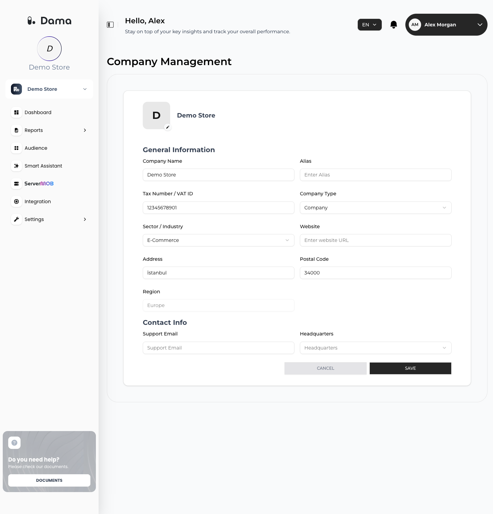

The **Company Profile** screen holds your company's details. One of them changes what you see in DAMA: **Sector / Industry** decides whether revenue cards appear on the [Dashboard](/user-guide/dashboard).

Open the company and go to **Settings → Company Profile**. The screen is titled **Company Management**. Every active member of the company can view and edit it.

<Frame>
  
</Frame>

## Fields

### General Information

| Field | Required | Notes |
| --- | --- | --- |
| **Company Name** | Yes | At least 2 characters |
| **Alias** | No | A short or alternative name |
| **Tax Number / VAT ID** | No | |
| **Company Type** | Yes | **Individual** or **Company** |
| **Sector / Industry** | No | **E-Commerce**, **Entertainment**, **Gaming** or **Finance** |
| **Website** | No | |
| **Address** | No | |
| **Postal Code** | No | |
| **Region** | — | Read-only. The region chosen when the company was created (**Europe**, **North America** or **Asia**). It can't be changed. If no region is recorded for the company, it shows **Not specified**. |

### Contact Info

| Field | Required | Notes |
| --- | --- | --- |
| **Support Email** | No | Must be a valid email address |
| **Headquarters** | No | Choose a city from the list |

## Edit the profile

1. Change the fields you need.
2. Click **SAVE**. You see *Company profile updated successfully*.

Click **CANCEL** to discard your changes.

## Sector and the Dashboard

Set **Sector / Industry** to **E-Commerce** or **Finance** to show **Total Revenue** and **Total Conversions** on the Dashboard. For other sectors, or when no sector is set, the Dashboard shows only users and sessions.

After you change the sector, open the company again from your company list or from the company menu in the sidebar for the Dashboard to pick up the change.
