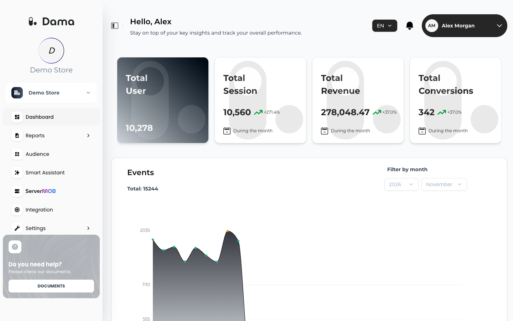

The **Dashboard** is the first screen you see after you select a company. It gives a quick overview of activity across all apps (Web, iOS and Android) connected to the company.

Go to **Dashboard** in the left menu.

<Frame>
  
</Frame>

## Summary cards

The cards at the top cover the **last 30 days**. Where a card shows a percentage with an arrow, it compares the last 30 days with the 30 days before (labelled **During the month**).

| Card | What it counts | Comparison |
| --- | --- | --- |
| **Total User** | Distinct users who sent at least one event in the last 30 days | None. The card shows the count only. |
| **Total Session** | Sessions that started in the last 30 days | Yes |
| **Total Revenue** | Total value of `purchase` events in the last 30 days, converted to your reporting currency (see below) | Yes |
| **Total Conversions** | Number of `purchase` events in the last 30 days | Yes |

<Note>
  **Total Revenue** and **Total Conversions** only appear when the company's **Sector / Industry** is **E-Commerce** or **Finance**. You can change the sector in [Company Profile](/user-guide/company-profile).
</Note>

### Revenue currency

**Total Revenue** converts each purchase into your company's reporting currency using the exchange rate for the day of the purchase. Purchases in **TRY**, **USD**, **EUR** and **GBP** are converted. If a purchase has no currency, or a currency DAMA doesn't recognize, its value is counted as if it were already in the reporting currency.

The reporting currency is Turkish lira (TRY) unless DAMA has set a different one for your company. The card shows the amount without a currency symbol. See [Purchase: value and currency](/setup/send-events#purchase-value-and-currency) for what to send.

## Events

A daily chart of all events your apps sent during one month. **Total** shows the month's event count. Hover over a day to see its date and its most frequent event names (up to 10), with the count of each.

Use **Filter by month** to pick a year (the current year or one of the two before it) and a month.

## Sessions

A daily chart of sessions during one month, by the day each session started. **Total** shows the month's session count.

Hover over a day to see its top traffic sources, shown as *source / medium* (for example *Google / CPC*), up to five combinations. The breakdown comes from the UTM parameters (`utm_source`, `utm_medium`) of the session. Sessions without UTM parameters count toward the total but not toward the breakdown.

Use **Filter by month** to pick a year and a month.

## Daily sessions by platform

Three cards, one each for **iOS**, **Android** and **Web**, show sessions per day over the last 30 days. **Change** compares the sessions of the last 7 days with the 7 days before. A platform with no sessions shows *No data available*.

## Top pages and products

Two tabs list the top 10 of the last 30 days:

| Tab | Based on | Columns |
| --- | --- | --- |
| **Page** | `page_view` events, grouped by page path | **Page**, **Visitors** (distinct users), **View** (number of page views) |
| **Product** | `view_item` events, grouped by page path | **Product**, **Visitors**, **View** |

Products are listed by the page path of the `view_item` event, so send `view_item` from the product detail page. Click the copy icon next to an entry to copy it.

## RFM and cLTV summaries

At the bottom of the screen you see compact versions of your latest results:

- **RFM Reports**: how many customers are in the **Need attention**, **At-risk** and **Novice** segments, and their share of all scored customers. The full breakdown is on the [RFM](/user-guide/rfm) screen.
- **cLTV Reports**: the cLTV distribution with the share of **Profitable** customers and the **Total Customers** count. See [cLTV](/user-guide/cltv).

*No RFM data available* or *No CLTV data available* means DAMA has no scored customers yet: no `purchase` events have arrived, or the first calculation hasn't run yet.

## How fresh is the data?

Dashboard figures are calculated once a day, per calendar day in UTC. A day's activity usually appears during the following day, so today's events are not on the Dashboard yet. **Total User** and the top pages and products are also refreshed once a day.

## Troubleshooting

<AccordionGroup>
  <Accordion title="Total Revenue and Total Conversions are missing.">
    Set **Sector / Industry** to **E-Commerce** or **Finance** in [Company Profile](/user-guide/company-profile).
  </Accordion>
  <Accordion title="Today's events don't appear.">
    The Dashboard is calculated once a day. Check again tomorrow, or use [Verify your installation](/setup/verify-installation) to confirm that events arrive.
  </Accordion>
  <Accordion title="The Product tab is empty.">
    DAMA hasn't received `view_item` events in the last 30 days. See [Standard events](/setup/send-events#standard-events).
  </Accordion>
  <Accordion title="The Sessions chart has no breakdown when I hover.">
    None of the day's sessions had UTM parameters on the landing URL.
  </Accordion>
</AccordionGroup>
