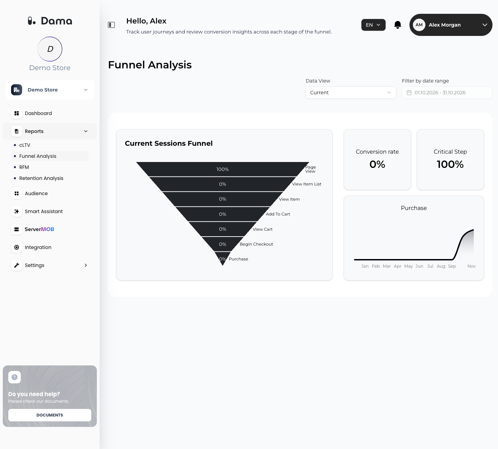

**Funnel Analysis** shows how many sessions reach each step of your shopping funnel, in order, and where the biggest drop-off happens.

Go to **Reports → Funnel Analysis**.

<Frame>
  
</Frame>

## Funnel steps

The funnel uses these events, in this order. The chart labels each step as shown in the second column.

| Step | Label in the chart | Event |
| --- | --- | --- |
| 1 | **Page View** | `page_view` |
| 2 | **View Item List** | `view_item_list` |
| 3 | **View Item** | `view_item` |
| 4 | **Add To Cart** | `add_to_cart` |
| 5 | **View Cart** | `view_cart` |
| 6 | **Begin Checkout** | `begin_checkout` |
| 7 | **Purchase** | `purchase` |

Your apps need to send these events, each with a session. If you don't send one of them, that step and every step after it show 0%. See [Standard events](/setup/send-events#standard-events).

## How it is calculated

The funnel is **session-based**:

1. DAMA takes every session that started in the selected period and sent a `page_view`. That number is 100%.
2. For each next step, a session counts only if it sent that step's event **after** it reached the previous step. A session that never sends the next step's event stops at the last step it reached.
3. Each step shows the share of step-1 sessions that reached it.

A session belongs to the day (UTC) it started, even if some of its events happen after midnight.

| Metric | Meaning |
| --- | --- |
| **Conversion rate** | Share of step-1 sessions that reached `purchase` |
| **Critical Step** | The largest drop between two consecutive steps, in percentage points |

<Tip>
  Each step in the chart is drawn narrower than the one above it. Read the percentage labels for the real values; the widths only show the shape.
</Tip>

## Choose the period

Use **Data View**:

| Option | Period |
| --- | --- |
| **Current** | The last 30 days. The chart title is **Current Sessions Funnel**. |
| **Filtered** | The date range you pick in **Filter by date range**. The chart title is **Filtered Sessions Funnel**. |

**Filter by date range** is active only in **Filtered**. The range starts as the previous calendar month and can be **at most 60 days**, counting both the start and end dates; once you pick a start date, the calendar only lets you pick an end date within that limit. If a range can't be loaded, you see *Couldn't load data for the selected date range. Please choose a valid range of up to 60 days.*

Dates are calendar days in UTC.

## Purchase chart

The **Purchase** chart next to the funnel shows the number of `purchase` events per month over the last 12 months, including the current month. It does not change with **Data View**.

## How fresh is the data?

The funnel is calculated once a day for the previous day (UTC). Today's sessions are not in the funnel yet.

## Using BigQuery as the source

If you connected [BigQuery](/integrations/bigquery) and chose **BigQuery** as the [Report data source](/integrations/bigquery#report-data-source), the funnel is built from your GA4 export instead, with the same steps and rules. GA4's `ga_session_id` identifies the session. DAMA processes the previous day every night; the first time it runs after the connection is verified, it also fills in the last 90 days. These queries count toward your [daily scan limit](/integrations/bigquery#costs-and-the-daily-scan-limit).

## Troubleshooting

<AccordionGroup>
  <Accordion title="The funnel shows Nothing to show or No data available.">
    No session with a `page_view` was found in the period. Check that your apps send `page_view`, or pick a different period.
  </Accordion>
  <Accordion title="A step shows 0%, and every step after it shows 0% too.">
    No session reached that step in order during the period. Check that your apps send that step's event. Because each step requires the previous one, a missing event also empties every later step. For example, if you don't send `view_item_list`, every step from **View Item List** onward shows 0%.
  </Accordion>
  <Accordion title="Numbers differ from a simple event count.">
    The funnel counts sessions that complete the steps in order. A session that adds to cart without a `view_item` earlier in the same session is not counted at the **Add To Cart** step.
  </Accordion>
  <Accordion title="Yesterday's or today's sessions are missing.">
    The funnel is calculated once a day for the previous day. Check again later.
  </Accordion>
</AccordionGroup>
