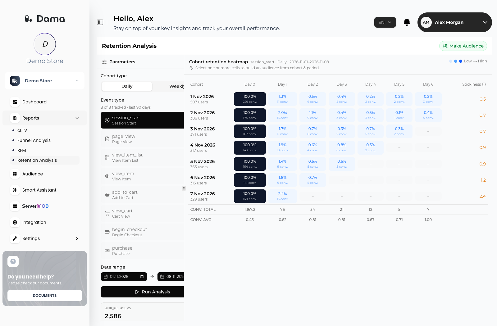
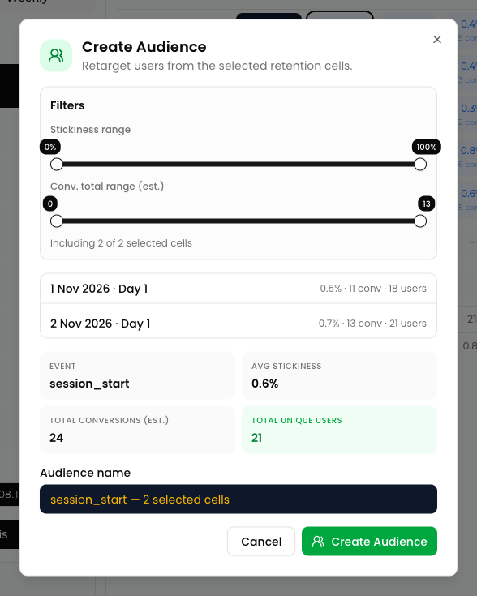

**Retention Analysis** groups users into **cohorts** by the day or week of their first session and shows what share of each cohort performed an event of your choice in each period afterwards. You can select cells of the heatmap and turn those users into an audience.

Go to **Reports → Retention Analysis**.

<Frame>
  
</Frame>

## Before you start

Cohorts are built **only from `session_start` events**. A user enters a cohort on the day or week of the first `session_start` DAMA received for them. If your apps don't send `session_start`, every cohort shows **0 users**, whatever event you analyze.

<Warning>
  The Web SDK does not send `session_start` automatically. Add it as described in [Session start](/setup/send-events#session-start). Apps and HTTP integrations must send it at the start of every session too.
</Warning>

## Run an analysis

In the **Parameters** panel:

<Steps>
  <Step title="Choose a Cohort type">
    **Daily** or **Weekly**. This sets both how users are grouped and the length of each period.
  </Step>
  <Step title="Choose an Event type">
    The event that counts as "coming back". The list shows the standard events and how many of them your apps sent in the last 90 days (for example, *6 of 8 tracked · last 90 days*). Events you haven't sent are marked **Not tracked** and can't be selected.
  </Step>
  <Step title="Set the Date range">
    The start date sets the first cohort. The end date is the last day DAMA counts activity for. Set both before you run the analysis.
  </Step>
  <Step title="Click Run Analysis">
    The **Cohort retention heatmap** appears. Its subtitle repeats your choices: event, cohort type and date range.
  </Step>
</Steps>

### Events you can analyze

| Event | Label in the list | Notes |
| --- | --- | --- |
| `session_start` | **Session Start** | Also marked as tracked when you send `page_view`, even if you don't send `session_start`. See [Before you start](#before-you-start). |
| `page_view` | **Page View** | |
| `view_item_list` | **View Item List** | Also marked as tracked when you send `view_item` |
| `view_item` | **View Item** | |
| `add_to_cart` | **Add to Cart** | |
| `view_cart` | **Cart View** | |
| `begin_checkout` | **Begin Checkout** | |
| `purchase` | **Purchase** | |

## How cohorts are built

- **Cohort**: a user belongs to the cohort of the period in which they sent their **first** `session_start`. Users whose first `session_start` is earlier than the first cohort are not included.
- **Periods** are calendar-aligned in UTC: days, or weeks starting on Monday.
- **Grid size** depends on the cohort type:

  | Cohort type | Cohorts (rows) | Periods (columns) | Column labels |
  | --- | --- | --- | --- |
  | **Daily** | 7 | 7 | Day 0 – Day 6 |
  | **Weekly** | 5 | 5 | Day 0 – Day 4 (each column is one week) |

  The first row is the day or week that contains your start date; each next row is the following period.

## How to read the heatmap

Each row is a cohort. The **Cohort** column shows the cohort's start date and size (*N users*).

- **Day 0** is the cohort's own period. With **Session Start** as the event it is always 100%; with another event it is the share of the cohort that sent that event in its first period.
- Each later cell shows the **percentage of the cohort that sent the selected event in that period**.
- Every period is counted **independently**. A user who skips Day 1 and comes back on Day 2 still counts on Day 2.
- Cells for periods that have not finished yet (after your end date, or after today) show **–**.
- Darker cells mean higher retention (**Low → High**).

### Stickiness

The **Stickiness** column is the cohort's average retention over its **completed periods after Day 0**, shown as a percentage value without the % sign. For example, **2.2** means that, on average, 2.2% of the cohort came back in each later period. Hover over the info icon next to **Stickiness** for a short explanation.

### Conversions (est.)

DAMA scores shopping intent with weights. For every user in a period, it takes the deepest shopping event the user reached in that period:

| Event | Weight |
| --- | --- |
| `add_to_cart` | 2 |
| `view_cart` | 2.5 |
| `begin_checkout` | 3 |
| `purchase` | 4 |

Users with none of these events add 0. The score indicates purchase intent; it is not a count of orders.

The footer shows, for each column:

- **CONV. TOTAL**: the sum of the scores of all users in that column's cells.
- **CONV. AVG**: CONV. TOTAL divided by the number of users in that column's cells.

Each cell also shows an estimate (*N conv.*): the number of users in the cell multiplied by the column's **CONV. AVG**.

### Summary cards

The cards in the **Parameters** panel fill in after you run the analysis:

| Card | Meaning |
| --- | --- |
| **UNIQUE USERS** | Distinct users who appear in at least one cell (*across all cohorts*) |
| **AVG DAY-1 RETENTION** | Average of the Day 1 retention across cohorts (*cohort average*) |
| **CONV. AVG** | Average of the columns' CONV. AVG values (*events / user*) |

## Create an audience from cells

<Steps>
  <Step title="Select cells">
    Click one or more cells in the heatmap. The chip at the top shows how many cells and users are selected (for example, *2 cells selected · 1,387 users*). Click a cell again to deselect it.
  </Step>
  <Step title="Click Make Audience">
    The **Create Audience** dialog opens. For one cell it shows the **EVENT**, **COHORT · WINDOW**, **RETENTION**, **STICKINESS**, **CONVERSIONS (EST.)** and **UNIQUE USERS**. For several cells it lists each cell and shows the **AVG STICKINESS**, **TOTAL CONVERSIONS (EST.)** and **TOTAL UNIQUE USERS**.
  </Step>
  <Step title="Narrow the selection (optional)">
    With several cells selected, use **Filters** to keep only cells whose cohort **Stickiness range** or **Conv. total range (est.)** falls within the limits. The dialog shows how many of the selected cells are included, and the user count updates.
  </Step>
  <Step title="Name and create">
    Edit the **Audience name** (a name such as *page_view — 2026-10-26 retained @ Day 1* is suggested) and click **Create Audience**.
  </Step>
</Steps>

<Frame>
  
</Frame>

The audience contains every distinct user in the included cells. It appears on the [Audience](/user-guide/audiences) screen, where you can send it to Google Ads or Meta.

If you click **Make Audience** without selecting a cell, *Select a cell first* reminds you to pick one.

<Note>
  Create the audience within 24 hours of running the analysis. If you see *Run the analysis again before creating an audience.*, click **Run Analysis** again.
</Note>

## Using BigQuery as the source

If you connected [BigQuery](/integrations/bigquery) and chose **BigQuery** as the [Report data source](/integrations/bigquery#report-data-source), Retention Analysis reads your GA4 export instead:

- Users are placed in cohorts by GA4's `first_open` or `first_visit` event.
- The event list also shows the event names found in your GA4 export.
- The analysis fails if more than 200,000 users fall in the cohort range. Choose a shorter date range.
- Each analysis counts toward your [daily scan limit](/integrations/bigquery#costs-and-the-daily-scan-limit).

## Troubleshooting

<AccordionGroup>
  <Accordion title="Every cohort shows 0 users, although Session Start is marked as tracked.">
    Your apps send `page_view` but not `session_start`. The event list marks **Session Start** as tracked when it sees `page_view`, but cohorts need real `session_start` events. Add `session_start` as described in [Session start](/setup/send-events#session-start). Users enter cohorts from the day DAMA receives their first `session_start`.
  </Accordion>
  <Accordion title="Cohorts are very small, or only the latest rows have users.">
    Only users whose first `session_start` falls in the cohort range are counted. Users who started sessions before your start date belong to earlier cohorts. If you started sending `session_start` recently, older cohorts stay empty. Try a later start date, or **Weekly**.
  </Accordion>
  <Accordion title="The last columns show –.">
    Those periods have not finished yet, or fall after your end date.
  </Accordion>
  <Accordion title="No events tracked in the last 90 days.">
    DAMA has not received any of the listed events from your apps in the last 90 days. Check your setup with [Verify your installation](/setup/verify-installation).
  </Accordion>
  <Accordion title="Couldn't run the analysis.">
    Check the date range (the end date must be after the start date) and try again. With BigQuery as the source, the range may contain too many users or exceed your daily scan limit.
  </Accordion>
</AccordionGroup>

See [Standard events](/setup/send-events#standard-events) for the events Retention Analysis uses.
