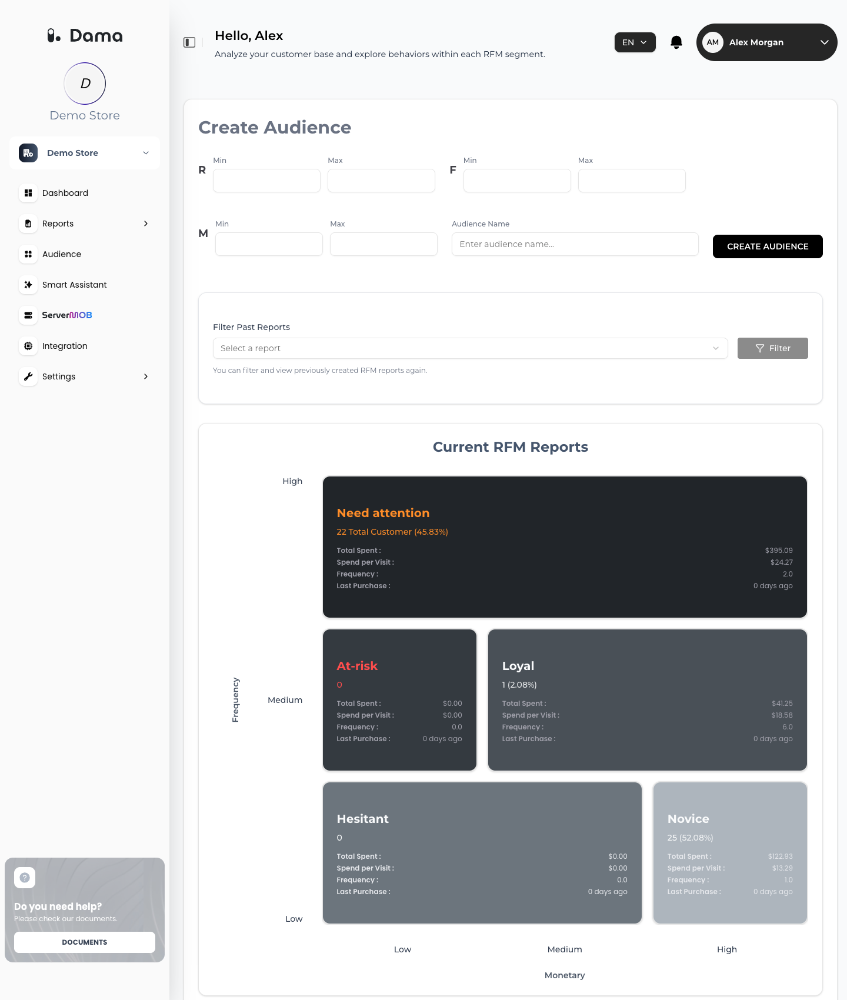

**RFM** scores every purchasing customer on three dimensions and groups them into segments, so you can see who your best customers are, who is drifting away and who is new.

Go to **Reports → RFM**.

<Frame>
  
</Frame>

## What RFM needs

RFM is built from `purchase` events with a purchase value. Each customer is a DAMA user: a signed-in customer identified by their email hash, or an anonymous visitor (see [Identify users](/setup/identify-users)). Customers with no purchase in the last **365 days** are not included.

Scores are calculated separately for each app (Web, iOS, Android) of the company and then shown together.

See [Purchase: value and currency](/setup/send-events#purchase-value-and-currency) for what to send with `purchase`.

## How customers are scored

For each customer, DAMA looks at their purchases in the last 365 days:

| Dimension | Raw value |
| --- | --- |
| **Recency** | Days since the customer's last purchase |
| **Frequency** | Number of purchases |
| **Monetary** | Total purchase value |

Each dimension is turned into a score from **1** (lowest) to **5** (highest).

### Recency score (fixed thresholds)

| Days since last purchase | R score |
| --- | --- |
| 0–7 | 5 |
| 8–21 | 4 |
| 22–42 | 3 |
| 43–84 | 2 |
| 85 or more | 1 |

### Frequency and Monetary scores (relative to your customers)

Frequency and Monetary are scored relative to your own customers. DAMA splits customers into five groups of similar values using a clustering algorithm (k-means) and ranks the groups: the group with the lowest values gets 1, the highest gets 5. Groups are not equal in size.

This means the same purchase count can score differently for two companies, and can change over time as your customer base changes. If every customer has the same value (for example, everyone bought exactly once), everyone gets a score of 3 for that dimension.

## Segments

Every customer is placed in one segment based on their scores. The rules are checked in this order, and the first match wins:

| Segment | Rule |
| --- | --- |
| **Loyal** | R ≥ 4, F ≥ 4 and M ≥ 4 |
| **Need attention** | R ≥ 4, and F is 2–3 or M is 2–3 |
| **Hesitant** | R is 2–3, and F ≥ 3 or M ≥ 3 |
| **Novice** | R ≥ 3, F ≤ 2 and M ≤ 2 |
| **At-risk** | R ≤ 2, F ≤ 2 and M ≤ 2 |

Customers who match none of the rules are counted in the total but don't have a segment card.

## How to read the screen

**Current RFM Reports** shows your whole customer base as five segment cards. The cards are laid out on a grid labelled **Frequency** (**High**, **Medium**, **Low**) and **Monetary** (**Low** → **High**); the layout is a visual guide, and the rules above decide who is in each segment.

Each card shows:

| Field | Meaning |
| --- | --- |
| Customer count and % | Number of customers in the segment and their share of all scored customers |
| **Total Spent** | Sum of the segment's purchase values |
| **Spend per Visit** | Total Spent ÷ the segment's total number of purchases |
| **Frequency** | Average number of purchases per customer |
| **Last Purchase** | Average number of days between the customers' last purchase and the latest calculation (*N days ago*) |

<Note>
  **Total Spent** and **Spend per Visit** add up purchase values exactly as you sent them, without currency conversion. The cards show a **$** sign whatever currency your purchases use, so read the amounts in the currency of your purchases, and send all purchases of an app in the same currency.
</Note>

The first time you open the screen, DAMA creates the initial report automatically (*Preparing the initial RFM report*).

## Create an audience from score ranges

<Steps>
  <Step title="Set score ranges">
    Under **Create Audience**, enter a **Min** and/or **Max** for **R**, **F** and **M**. Values are scores from 1 to 5. Leave a field empty to not filter on it. **Max** must be greater than or equal to **Min**.
  </Step>
  <Step title="Name the audience">
    Enter an **Audience Name**. If you leave it empty, DAMA uses a default name.
  </Step>
  <Step title="Create">
    Click **CREATE AUDIENCE**. The audience contains the customers whose current scores fall within all of the ranges you set.
  </Step>
</Steps>

For example, R min 4 and F min 4 gives you recent, frequent buyers. R max 2 gives you customers whose last purchase was more than 42 days ago.

The audience appears on the [Audience](/user-guide/audiences) screen, and its segment breakdown is shown under **Filtered RFM Reports**. If no customer matches the ranges, no audience is created.

### View a past report

Every audience you create here is saved as a report. Under **Filter Past Reports**, choose a report in **Select a report** and click **Filter** to see its breakdown again.

## How often RFM is updated

DAMA recalculates RFM about once a day when new purchases have arrived since the last calculation.

If your [Report data source](/integrations/bigquery#report-data-source) is **BigQuery**, RFM is calculated from your GA4 export once a week (Thursday night), and on the first night after you change the source. Monetary values then come from GA4's USD purchase values.

## Troubleshooting

<AccordionGroup>
  <Accordion title="Failed to create the initial RFM report, or Nothing to show.">
    DAMA found no `purchase` events in the last 365 days, or the first calculation hasn't run yet. Check that your apps send `purchase` with a value, then check again the next day.
  </Accordion>
  <Accordion title="Most customers are in one segment.">
    This is common when most customers have bought only once: Frequency then barely separates customers. The split becomes more useful as repeat purchases accumulate.
  </Accordion>
  <Accordion title="Total Spent looks too high or too low.">
    Purchase values are added up as sent. If an app sends purchases in more than one currency, or sends the value in minor units (for example cents), the totals mix them. See [Purchase: value and currency](/setup/send-events#purchase-value-and-currency).
  </Accordion>
</AccordionGroup>
