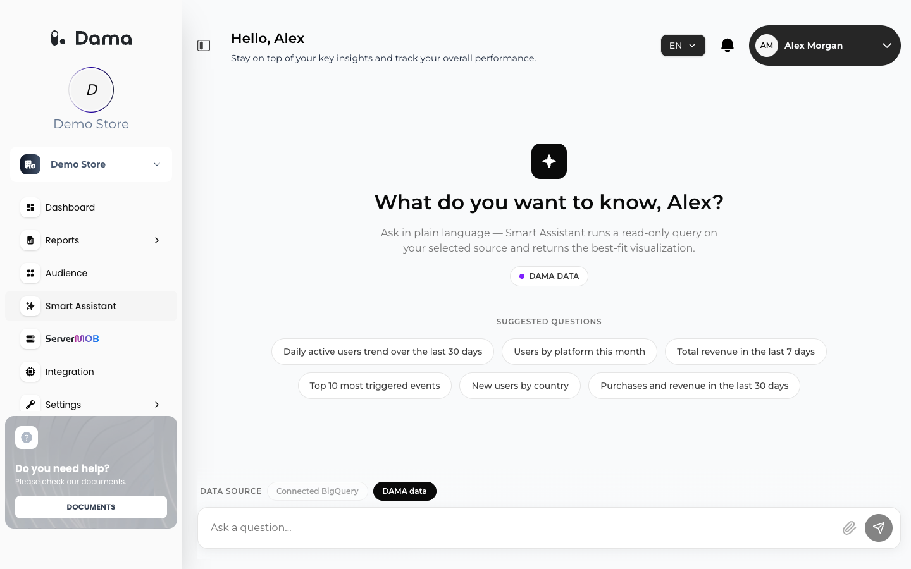

The **Smart Assistant** answers questions about your data in plain language. You type a question such as *"Daily active users trend over the last 30 days"*; the Smart Assistant turns it into a read-only query, runs it on the data source you selected, and shows the result as the best-fitting visualization.

Go to **Smart Assistant** in the left menu.

<Frame>
  
</Frame>

## Data sources

Pick the source under **DATA SOURCE**, below the suggested questions. The badge on the welcome screen (**DAMA DATA** or **CONNECTED BIGQUERY**) shows the selected one.

| Source | What it answers from | Requirement |
| --- | --- | --- |
| **DAMA data** | The events your apps send to DAMA and the reports DAMA calculates from them | At least one app connected to the company. |
| **Connected BigQuery** | Your GA4 export in BigQuery | A verified [BigQuery connection](/integrations/bigquery). Until then the option is greyed out; hover over it to see *Connect and verify BigQuery in the integration settings to use it.* |

When BigQuery is connected and verified, **Connected BigQuery** is selected by default; otherwise **DAMA data** is.

### What DAMA data can answer

With **DAMA data**, the Smart Assistant doesn't write free-form queries. It picks one of DAMA's built-in metrics and its settings (period, platform, breakdown, top N) and runs it on your company's data:

- Sessions, events, product views (`view_item`), purchases and revenue, per day, week or month, for up to about a year. Revenue is converted to your reporting currency, as on the [Dashboard](/user-guide/dashboard#revenue-currency).
- Conversion rate (orders per 100 sessions), top events and traffic sources (UTM source and medium).
- The session funnel, users in the last 30 days, and the top 10 pages and products of the last 30 days.
- Customers per RFM segment and customers by number of purchases. Spending amounts from RFM and cLTV are not available here.
- Retention cohorts, active users (up to 92 days) and revenue per user (ARPU and ARPPU, 7 to 30 days), optionally for one platform.
- Event counts, distinct users, sessions or revenue over the raw events of up to 90 days, broken down by event name, country, device, browser, channel, UTM parameters, page path, language or platform.

Daily figures cover the days DAMA has finished calculating, usually up to yesterday.

## Ask a question

<Steps>
  <Step title="Choose the data source">
    Under **DATA SOURCE**, click **DAMA data** or **Connected BigQuery**.
  </Step>
  <Step title="Type your question">
    Type in **Ask a question…**, or click one of the **SUGGESTED QUESTIONS**. You can ask in English or Turkish.
  </Step>
  <Step title="Follow the progress">
    The Smart Assistant shows its steps: **Question understood**, **Source selected**, **Query generated** (*read-only SQL*), **Running query** and **Preparing visualization**. For BigQuery, **Running query** also shows how much data is being scanned.
  </Step>
  <Step title="Read the result">
    The answer appears as **KPI cards**, a **line chart**, a **bar chart**, a **table** or a **cohort grid**. If summaries are enabled for your company, a one- or two-sentence summary appears above the result.
  </Step>
</Steps>

### Follow-up questions

Ask a follow-up in the same conversation (for example *"break this down by channel"*). The Smart Assistant takes the earlier questions of the conversation into account. Only one question can be answered at a time in a conversation.

Click **+** (*Start a new conversation*) to start over.

## Work with a result

| Action | Available for | What it does |
| --- | --- | --- |
| **View SQL** | Tables and cohort grids | Shows the read-only query that produced the result, with a **Copy** button. For **DAMA data** it shows the metric and settings DAMA ran. |
| **Download CSV** | Tables and cohort grids | Downloads the result as a CSV file. |
| **Switch to bar** / **Switch to line** | Line and bar charts | Changes the chart type. |

Results are limited in size: up to 1,000 rows for line charts and cohort grids, 500 rows for tables, 50 bars for bar charts, and 8 KPI cards.

## Safety and cost

- **Read-only.** With **DAMA data**, the Smart Assistant can only run DAMA's built-in metrics on your own company's data. With **Connected BigQuery**, every generated query is checked with a BigQuery dry run before it runs; anything that is not a `SELECT`, or that reads tables outside your connected dataset, is refused.
- **BigQuery costs.** BigQuery queries run in your Google Cloud project and are billed there. Before running, DAMA estimates how much data the query will scan. If that is more than what is left of your **Daily scan limit** for the day (UTC), the question is not run and you see *This query would exceed your daily BigQuery scan limit.* See [Costs and the daily scan limit](/integrations/bigquery#costs-and-the-daily-scan-limit).
- **Timeouts.** Long-running queries are stopped. Narrow the date range and try again.
- **Your conversations are private to you.** Other team members don't see them.

### What the AI model receives

The Smart Assistant uses an AI model to turn your question into a query and, if summaries are enabled, to write the summary. The model receives:

- Your question, the earlier questions in the conversation and how they were interpreted, today's date and your language.
- For **DAMA data**: the list of built-in metrics and a short description of your company's data: reporting currency, the latest calculated day, the tracked platforms, the funnel steps and your up to 30 most frequent event names.
- For **Connected BigQuery**: the table and column names and types of your connected dataset.
- Only when summaries are enabled: the result's column names and up to its first 30 rows.

Other result data is not sent to the model.

## Tips for good questions

- Name the metric and the period: *"Purchases and revenue in the last 30 days"*.
- Say how to break it down: *"Users by platform this month"*, *"New users by country"*.
- Ask for a top list explicitly: *"Top 10 most triggered events"*.
- With BigQuery, GA4 export tables for today are partial. Unless you ask about today, the Smart Assistant uses the completed daily tables.

## Troubleshooting

<AccordionGroup>
  <Accordion title="Connected BigQuery is greyed out.">
    Connect and verify BigQuery in **Integration**. See [BigQuery](/integrations/bigquery).
  </Accordion>
  <Accordion title="Your connected BigQuery couldn't be reached.">
    DAMA could not access your dataset. Check that the service account still has its roles in Google Cloud. Click **Check BigQuery settings** to open the integration settings, then test the connection again.
  </Accordion>
  <Accordion title="This query would exceed your daily BigQuery scan limit.">
    Ask about a shorter period, or raise the **Daily scan limit** in the BigQuery integration settings. The limit resets at midnight UTC.
  </Accordion>
  <Accordion title="The query took too long and was stopped.">
    Narrow the date range or simplify the question.
  </Accordion>
  <Accordion title="Another question is still being answered in this conversation.">
    Wait for the current answer, or start a new conversation.
  </Accordion>
  <Accordion title="No data was returned for this question.">
    The query ran but found no matching rows. Check the period and the event names you used. With DAMA data, today's activity is not calculated yet.
  </Accordion>
  <Accordion title="Smart Assistant isn't available right now.">
    The Smart Assistant is not enabled for your company. Ask your DAMA contact to enable it.
  </Accordion>
</AccordionGroup>
