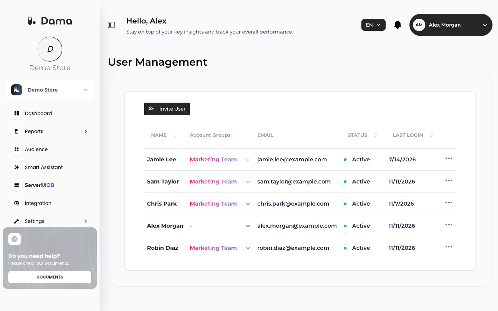
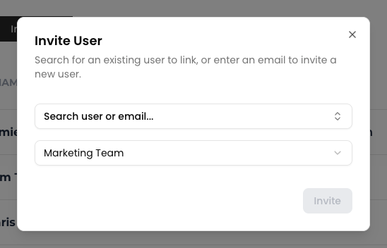
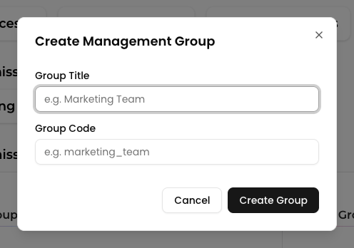

You manage who can work in a company from the **Settings** menu:

- **User Management**: invite people, change their management group, and activate or deactivate them.
- **User Management Groups**: create and delete management groups for your team.

## User Management

Open the company and go to **Settings → User Management**.

<Note>
  **User Management** is only shown for companies you own (the companies created from your account). People you invited from another account don't see it.
</Note>

<Frame>
  
</Frame>

The table lists everyone who is a member of the company:

| Column | Meaning |
| --- | --- |
| **NAME** | The person's name |
| **Account Groups** | The management group they belong to in this company, or **-** if they aren't in a group |
| **EMAIL** | Their sign-in email |
| **STATUS** | **Active** or **Inactive** for this company |
| **LAST LOGIN** | The date they last signed in, or **Never** |

### Invite a team member

Create at least one management group first (see [Create a group](#create-a-group)); every invited person is added to a group.

<Steps>
  <Step title="Open the invite dialog">
    Click **Invite User**.
  </Step>
  <Step title="Find or enter the person">
    Click **Search user or email...** and start typing.

    - To add someone who already has a DAMA account under your account, type at least 3 characters of their name or email and pick them under **Existing Users**.
    - Otherwise, type their full email address and choose it under **Invite New** (*Select to invite*).
  </Step>
  <Step title="Choose a group">
    Pick the management group the person should belong to. The first group is selected by default.
  </Step>
  <Step title="Send">
    Click **Invite**.
  </Step>
</Steps>

What happens next depends on the person:

- **Picked under Existing Users**: they get access right away (*User linked successfully*) and receive an email with a link to sign in.
- **New to DAMA**: they receive an invitation email (*Invitation sent successfully*). They create their account from the link, which is valid for **24 hours**. See [Accept an invitation](/user-guide/account#accept-an-invitation). If the link expires, invite them again.
- **Already has a DAMA account elsewhere**: they get access right away and receive an email with a link to sign in.

<Frame>
  
</Frame>

### Change someone's group

Click the group in the person's row and choose another group under **Account Groups**. You see *Role updated to …*.

### Deactivate or reactivate access

Click **⋯** at the end of the person's row and choose **Inactive** or **Active** under **STATUS**. You see *Status updated to …*.

An inactive person can no longer open this company: it disappears from their company list. Their account and their access to other companies are not affected. Set them back to **Active** to restore access.

## User Management Groups

Go to **Settings → User Management Groups**. You can also open it from the company menu in the sidebar.

A management group is a named role, such as *Marketing Team*. Each team member belongs to one group per company. The groups are shared by all companies you own, so you can reuse the same groups everywhere.

### Create a group

1. Click **CREATE MANAGEMENT GROUP**.
2. Enter a **Group Title** (for example *Marketing Team*) and a **Group Code** (for example *marketing_team*). Both are required, and the code must be unique.
3. Click **Create Group**. You see *Group created successfully*.

<Frame>
  
</Frame>

<Note>
  Use groups to organize your team, for example by department. To control who can open a company, invite or [deactivate](#deactivate-or-reactivate-access) members.
</Note>

### Delete a group

Hover over the group under **Existing Permission Groups**, click the trash icon and confirm with **Delete**. You see *Group deleted successfully*.

Members of a deleted group keep their access to the company. In **User Management**, their group shows **-** until you choose another group for them.
